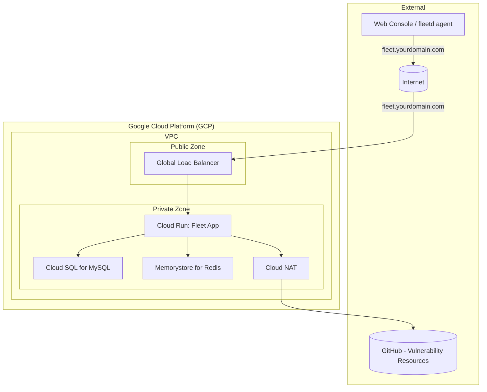

# Terraform Google Cloud Fleet Deployment

This Terraform project automates the deployment of Fleet Device Management (Fleet) on the Google Cloud Platform (GCP). By default it creates a new GCP project and deploys all necessary infrastructure components. To use an existing project instead, set `create_project = false` and provide a `project_id`.

## How to apply

**Run Terraform from this directory only** — the same place as `main.tf`, `variables.tf`, and `terraform.tfvars`.

```bash
terraform init
terraform plan
terraform apply
```

`byo-project/` is a **local module** (`source = "./byo-project"` in `main.tf`), not a separate root module. Do not `cd byo-project` and apply there — that layout does not work as a standalone stack with our wiring (root holds backend, provider, tfvars, and project selection).

It deploys:

*   A new GCP project (via `terraform-google-modules/project-factory`)
*   VPC Network and Subnets
*   Cloud NAT for outbound internet access
*   Cloud SQL for MySQL (database for Fleet)
*   Memorystore for Redis (caching for Fleet)
*   Google Cloud Storage (GCS) bucket (for Fleet software installers, S3-compatible access configured)
*   Google Secret Manager (for storing sensitive data like database passwords and Fleet server private key)
*   Cloud Run v2 Service (for the main Fleet application)
*   Cloud Run v2 Job (for database migrations)
*   External HTTP(S) Load Balancer with managed SSL certificate (unless you [bring your own load balancer](#bring-your-own-load-balancer-optional))
*   Cloud DNS for managing the Fleet endpoint
*   Appropriate IAM service accounts and permissions

## Prerequisites

1.  **Terraform:** Version `~> 1.11` (as specified in `main.tf`).
2.  **Google Cloud SDK (`gcloud`):** Installed and configured. Install from [cloud.google.com/sdk](https://cloud.google.com/sdk/docs/install).
3.  **GCP Account & Permissions:**
    *   Credentials configured for Terraform to interact with GCP. Run `gcloud auth application-default login`.
    *   The Terraform identity must be able to manage Cloud Run services and jobs (for example `roles/run.admin`). With `fleet_config.exec_migration = true`, Terraform also reads the Fleet service and the region's Cloud Run jobs and job executions (see [Database migration gate](#database-migration-gate)). Project `Owner`/`Editor` include these.
    *   **New project** (`create_project = true`, the default): `Organization Administrator` or `Folder Creator` & `Project Creator` at the org/folder level, plus `Billing Account User` on the billing account.
    *   **Existing project** (`create_project = false`): `Owner` or `Editor` on the target project, plus `roles/dns.admin` if managing Cloud DNS.
4.  **Registered Domain Name:** You will need a domain name that you can manage DNS records for. This project will create a Cloud DNS Managed Zone for this domain (or a subdomain).
5.  **(Optional) Fleet License Key:** If you have a premium Fleet license, you can provide it via `fleet_config.license_key`.

### APIs in an existing project

New projects automatically enable the Fleet baseline APIs. For `create_project = false`, API management remains **off by default**. Either pre-enable the baseline listed in [`api-management.tf`](./api-management.tf), plus any APIs your optional configuration needs, or opt in:

```hcl
create_project               = false
project_id                   = "your-existing-project-id"
manage_existing_project_apis = true
extra_apis                   = [] # additional APIs beyond the Fleet baseline
```

With this opt-in, Terraform enables the same baseline as new projects plus `extra_apis`, and waits for those APIs before creating Fleet resources. The Terraform identity needs permission to enable services, such as `roles/serviceusage.serviceUsageAdmin`. Opting out later or destroying the stack **does not disable these APIs**. Without the opt-in, `extra_apis` does not manage APIs in an existing project; some child resources still enable their individual APIs: Redis (through the Memorystore module, and before the Memorystore CMEK grant when `cmek.redis` is set), KMS when any CMEK setting is enabled, and Cloud Run when `cmek.cloud_run` is set. These per-feature activations don't cover every Fleet prerequisite. Direct callers of `byo-project` must manage the remaining prerequisites themselves.

**Adopting API management on an existing deployment.** On a fresh deployment, the opt-in works in a single `terraform apply`. If you set `manage_existing_project_apis = true` on a Fleet stack that is **already deployed**, or later change the managed API set (for example, `extra_apis`), the module-wide `depends_on` on the API resources can defer data sources inside the Fleet module. The plan may then propose replacing KMS and Secret Manager IAM bindings. To avoid that, apply only the API resources first from this directory, then run a normal apply and review the full plan:

```bash
terraform apply -target='google_project_service.existing_project_apis'
terraform apply
```

If you call this stack from a wrapper module, prefix the full module path, for example `-target='module.<your_module_name>.google_project_service.existing_project_apis'`. Use `-target` only for this adoption or change step. It is not part of normal deployments or fresh provisioning.

## Configuration

1.  **Create a `terraform.tfvars` file** with at minimum:

    ```hcl
    billing_account_id = "012345-6789AB-CDEFGH"
    org_id             = "111122223333"  # or use folder_id instead
    dns_zone_name      = "gcp.example.com."
    dns_record_name    = "fleet.gcp.example.com."

    fleet_config = {
      image_tag              = "fleetdm/fleet:v4.93.0"
      fleet_cpu              = "1000m"
      fleet_memory           = "4096Mi"
      debug_logging          = false
      min_instance_count     = 1
      max_instance_count     = 5
      exec_migration         = true
      use_h2c                = false
      installers_bucket_name = "your-globally-unique-bucket-name"
      # license_key           = ""
    }
    ```

    To use an existing project instead, omit `billing_account_id` and `org_id` and set:
    ```hcl
    create_project = false
    project_id     = "your-existing-project-id"
    ```

2.  **Required variables** (no defaults — must be set):

    | Variable | Description |
    |---|---|
    | `billing_account_id` | GCP Billing Account ID. Required when `create_project = true` (the default). |
    | `org_id` or `folder_id` | Where to create the project. Required when `create_project = true`. |
    | `dns_zone_name` | DNS zone managed in Cloud DNS (e.g., `gcp.example.com.`). **Must end with a dot.** |
    | `dns_record_name` | FQDN for Fleet (e.g., `fleet.gcp.example.com.`). **Must end with a dot.** |
    | `fleet_config.installers_bucket_name` | GCS bucket name for software installers. Must be globally unique. |

    When `create_project = false`, set `project_id` instead of `billing_account_id` and `org_id`/`folder_id`.

    Review `variables.tf` and `byo-project/variables.tf` for all available options and their defaults.

## Bring your own load balancer (optional)

By default the module creates a global (or, with `use_regional_lb = true`, regional) external Application Load Balancer. To front Fleet with an Application Load Balancer you own instead, disable the module-managed one:

```hcl
load_balancer_config = {
  enable = false
}
```

* **Cloud Run ingress does not change.** The Fleet service keeps `ingress = "INGRESS_TRAFFIC_INTERNAL_LOAD_BALANCER"` (Cloud Run's "Internal and Cloud Load Balancing" setting). Disabling the module-managed load balancer does **not** expose Fleet at a public Cloud Run URL. The module creates no public endpoint, certificate, or DNS record in this mode, so devices and users can't reach Fleet until you connect your own load balancer.
* **Connect your load balancer to `serverless_neg_id`.** This output is the ID of the regional serverless network endpoint group (NEG) the module already creates for the Fleet Cloud Run service (`terraform output serverless_neg_id`). Add it as a backend of your load balancer's backend service. The output is set whether or not the module-managed load balancer is enabled. Use a load balancer type that supports serverless NEG backends; a regional load balancer must be in the same `region` as Fleet.
* **You own the rest of the load balancer:** frontend IP and forwarding rules, certificates, HTTP-to-HTTPS redirect, URL map, backend service, logging, and DNS. In this mode `fleet_application_url`, `load_balancer_ip_address`, and `regional_cert_dns_authorization_record` are `null`, and `load_balancer_type` is `"none"`. No DNS A record is created, even with `dns_config.enable = true`. Point your DNS record at your own load balancer's address.
* **Module-managed Cloud Armor is not available.** `cloud_armor.enable = true` requires the module-managed regional load balancer. If you need a Cloud Armor policy, attach your own to your backend service. The [path guidance](#choosing-public-paths) below still applies when you choose which paths to allow.

## Cloud Armor allowlist (optional)

`cloud_armor` attaches an optional Cloud Armor security policy to the load balancer. It is **off by default** (`cloud_armor.enable = false`), and when it is off nothing is created.

When enabled, the policy is an explicit allowlist that you own:

| Input | Effect |
|---|---|
| `allowed_ip_ranges` | Requests from these source IP addresses or CIDR ranges are allowed to **any path**. `*` matches every source, which allows all traffic. |
| `allow_public_paths` | Requests whose path matches one of these RE2 regular expressions are allowed from **any source**. |
| everything else | Denied with **HTTP 403**. |

* **No Fleet endpoints are allowed automatically.** The module never adds default paths or IP ranges. You decide what is reachable.
* Either list may be empty. An IP-only policy (only `allowed_ip_ranges`) is valid. Enabling the policy with **both** lists empty is rejected at plan time, because it would return 403 for every request.
* **IP-only policies block devices outside those ranges.** With no `allow_public_paths`, fleetd/osquery agents and MDM-enrolled devices can reach Fleet only if their traffic comes from a listed range (for example, a VPN or office egress). Devices anywhere else get 403, so enrollment, check-ins, and MDM commands fail for them.
* `allow_public_paths` entries are RE2 regexes matched against the request path. Anchor them with `^` so they only match the intended path prefix. Each regex is passed to Cloud Armor as an escaped CEL string literal, so quotes and backslashes are safe and keep their regex meaning. In HCL, write a regex backslash as `\\` (for example, `"^/api/v\\d+/"`).
* Rules are chunked to fit Cloud Armor limits: up to 5 path regexes per rule (priorities 1000, 1010, …) and up to 10 IP ranges per rule (priorities 2000, 2010, …). The deny-all rule is the policy's default rule at priority 2147483647.
* **Plan-time validation.** When `cloud_armor.enable = true`, the root module and `byo-project` both reject invalid settings before anything is created. Each `allow_public_paths` entry must be a valid regular expression (checked with Terraform's `regexall`, which uses RE2 syntax). Each `allowed_ip_ranges` entry must be a valid IPv4 or IPv6 address (for example, `198.51.100.7` or `2001:db8::1`), a CIDR range (for example, `203.0.113.0/24` or `2001:db8::/32`), or `*`. Entries are passed to Cloud Armor exactly as you write them; bare addresses aren't rewritten to `/32` or `/128`. The module-managed regional load balancer must be enabled. Passing these checks doesn't guarantee Cloud Armor accepts every expression, so review the plan and apply results.

### Choosing public paths

Which paths your devices need depends on the Fleet features you use (osquery/fleetd, Fleet Desktop, Apple/Windows/Android MDM, and so on). For the most up-to-date, feature-by-feature list of endpoints, see Fleet's guide [Which API endpoints to expose to the public internet?](https://fleetdm.com/guides/what-api-endpoints-to-expose-to-the-public-internet). The [examples below](#examples) translate that guide's list into feature groups. They are not exhaustive or version-locked: if they differ from the guide, follow the guide, and confirm the paths against the Fleet version you run. Nothing is allowed unless you add it.

* fleetd's update (TUF) repository is normally not served by this load balancer. By default, fleetd downloads updates from `updates.fleetdm.com` (or from your own TUF server), so TUF paths usually do not belong in this list.
* **Device routes and admin routes are different.** The guide's "Using fleetctl CLI from outside your network" entries (`/api/setup`, `/api/*/setup`, `/api/*/fleet/*`) cover the admin API, not device traffic. A public `^/api/[^/]+/fleet/` pattern would allow nearly the whole REST API, including admin endpoints, from any source, and would make most device-specific patterns redundant. Prefer `allowed_ip_ranges` for admins, the web UI, and `fleetctl`.

The examples convert the guide's wildcard paths into anchored RE2 patterns:

| Guide form | RE2 pattern | Meaning |
|---|---|---|
| Trailing `/*`, for example `/api/osquery/*` | `^/api/osquery/` | Any path under that prefix |
| `*` inside a path, for example `/api/*/fleet/...` | `^/api/[^/]+/fleet/...` | Exactly one path segment, such as an API version (`v1`, `latest`) or a device token |
| Exact endpoint, for example `/mdm/apple/mdm` | `^/mdm/apple/mdm$` | That path only. Cloud Armor's `request.path` excludes the query string |
| Both a path and its `/*` sub-paths | `^/mdm/apple/service_discovery(/.*)?$` | The path itself and anything under it, but not a look-alike such as `/mdm/apple/service_discoveryX` |
| A literal `.`, for example `/.well-known/...` | `^/\.well-known/...` | An escaped dot. Inside an HCL string, write it as `\\.` |

After enabling, check the load balancer logs for 403 responses from managed devices and adjust the list.

### Requirements and limitations

* **Regional load balancer only.** Cloud Armor is currently wired only for the regional external Application Load Balancer. `cloud_armor.enable = true` requires `load_balancer_config.enable = true` and `load_balancer_config.use_regional_lb = true`. The global load balancer path is not supported.
* **Native Terraform attachment.** The regional backend uses `google-beta`'s `security_policy` field. Attachment, detachment, and drift are tracked by Terraform; no `gcloud` command or separate CLI login is required. The policy's allow/deny rules are configured before attachment.

### Examples

IP-only: admins and devices must all come from the listed ranges.

```hcl
load_balancer_config = {
  use_regional_lb = true
}

cloud_armor = {
  enable            = true
  allowed_ip_ranges = ["203.0.113.0/24", "198.51.100.7/32"]
}
```

Admin IP ranges plus public device paths for common features. Groups marked optional or "only if" apply only when you use that feature. Remove the groups you don't use:

```hcl
load_balancer_config = {
  use_regional_lb = true
}

cloud_armor = {
  enable            = true
  allowed_ip_ranges = ["203.0.113.0/24"] # admins, web UI, fleetctl: any path from these sources

  # Feature groups from Fleet's "Which API endpoints to expose to the public
  # internet?" guide, which has the most up-to-date list. Not complete for every
  # feature: verify against your Fleet version and add the optional groups below
  # only if you use them.
  allow_public_paths = [
    # osquery/fleetd hosts outside your VPN or intranet
    "^/api/osquery/",
    "^/api/v1/osquery/",

    # Fleet Desktop
    "^/api/[^/]+/fleet/device/[^/]+/desktop$", # required for Fleet Desktop
    "^/api/fleet/orbit/",                      # full Fleet Desktop and scripts functionality
    "^/api/fleet/device/ping$",                # full Fleet Desktop and scripts functionality

    # End-user "My device" page (frontend, static assets, and device API)
    "^/device/",
    "^/assets/",
    "^/api/[^/]+/fleet/device/", # listed by the guide under macOS MDM; covers the Desktop pattern above

    # Apple (macOS) MDM, including SCEP
    "^/mdm/apple/scep$",       # SCEP certificate enrollment
    "^/mdm/apple/mdm$",        # MDM protocol
    "^/api/mdm/apple/enroll$", # automatic enrollment profiles

    # Apple ACME: only if you use Hardware Attestation
    "^/api/mdm/acme/",

    # Windows MDM
    "^/api/mdm/microsoft/management$",
    "^/api/mdm/microsoft/discovery$",
    "^/api/mdm/microsoft/policy$",
    "^/api/mdm/microsoft/enroll$",
    "^/api/mdm/microsoft/tos$", # required for automatic enrollment

    # Optional: only if using Fleet as a SCEP proxy with a configured SCEP server
    "^/mdm/scep/proxy/",
  ]
}
```

Optional groups. Append these to `allow_public_paths` only for the features you use:

| Feature (when needed) | Patterns |
|---|---|
| macOS setup: end-user IdP authentication (SSO) | `"^/mdm/sso$"`, `"^/api/[^/]+/fleet/mdm/sso$"`, `"^/mdm/sso/callback$"`, `"^/api/[^/]+/fleet/mdm/sso/callback$"`, `"^/assets/"` |
| macOS setup: EULA | `"^/api/[^/]+/fleet/mdm/setup/eula/"` |
| macOS setup: bootstrap package | `"^/api/[^/]+/fleet/mdm/bootstrap$"` |
| macOS Platform SSO (Fleet's extension) | `"^/api/mdm/apple/psso/"`, `"^/\\.well-known/apple-app-site-association$"` |
| iOS/iPadOS enrollment page and profile | `"^/enroll$"`, `"^/api/[^/]+/fleet/enrollment_profiles/ota$"` |
| iOS/iPadOS in-house (`.ipa`) apps | `"^/api/[^/]+/fleet/software/titles/[^/]+/in_house_app$"` |
| iOS/iPadOS account-driven User Enrollment (BYOD) | `"^/api/mdm/apple/account_driven_enroll(/.*)?$"`, `"^/mdm/apple/account_driven_enroll/sso(/.*)?$"`, `"^/mdm/apple/service_discovery(/.*)?$"` |
| Android enrollment page and Android Enterprise | `"^/enroll$"`, `"^/api/[^/]+/fleet/android_enterprise/enrollment_token$"`, `"^/api/[^/]+/fleet/android_enterprise/pubsub$"` |
| Android Wi-Fi/VPN certificate deployment | `"^/api/fleetd/"` |

The guide also covers mTLS for some device endpoints (its "Advanced" section). Cloud Armor path allowlisting does not replace Fleet's endpoint authentication.

## Customer-managed encryption (CMEK)

CMEK uses Google Cloud KMS keys for encryption at rest, analogous to AWS KMS customer-managed keys. All new service options below are **unset/off by default**, independently of the existing GCS setting. Setting `cmek.enable = true` still enables **GCS-only** encryption; it does not opt existing databases, caches, services, or secrets into new encryption changes.

| Configuration | Scope | Required key location | Existing-resource consequence |
|---|---|---|---|
| `enable`, `create_kms`, `kms_key_ring`, `kms_crypto_key` | Existing GCS bucket encryption configuration; optionally creates its key | `location`, matching the bucket | Existing objects are not retroactively re-encrypted |
| `cloud_sql.kms_key_id` | Cloud SQL instance | `region` | **Instance replacement**; migrate/back up data before enabling |
| `redis.kms_key_id` | Memorystore Redis instance | `region` | **Instance replacement** |
| `cloud_run.kms_key_id` | Fleet service and migration job | `region` | Service revision/job template update |
| `secret_manager.kms_key_id` | Managed secrets with automatic replication | `global` | **Managed secret replacement** with the same IDs under the pinned provider |
| `secret_manager.replica_kms_key_ids` | Managed secrets with `replicate_secrets` set | One key in each replica's region | **Managed secret replacement** with the same IDs under the pinned provider |

The new consumers accept **full key IDs** for keys provisioned separately or by the caller's Terraform configuration; they do not create additional keys. The deployer must be allowed to grant key access to each service's Google-managed service agent. API enablement is a prerequisite, particularly for existing projects; use the opt-in above or pre-enable the required services. A regional key cannot be replaced by the default multi-region GCS key, and a global Secret Manager key cannot be used for a regional service.

**IAM propagation wait.** When any of `cmek.cloud_sql`, `cmek.redis`, `cmek.cloud_run`, or `cmek.secret_manager` is set, Terraform waits `cmek_iam_propagation_delay_seconds` (default `120`) after granting the service agents access to their keys and before creating the resources that use them. Google notes that IAM access changes [typically take about 2 minutes to propagate, and sometimes 7 minutes or longer](https://docs.cloud.google.com/iam/docs/access-change-propagation). Set it to a non-negative integer; `0` skips the wait. The wait is not a guarantee. If propagation takes longer, an apply can still fail, and you can re-run `terraform apply` after a few minutes. Don't assume every failure is a propagation delay: permission-denied errors that persist, or key location/region errors, point to a configuration problem (a missing grant permission, the wrong key, or a key in the wrong location) and won't resolve by waiting. The legacy GCS-only setting (`cmek.enable`) and the default configuration without CMEK don't wait.

**When the wait runs again.** The wait happens when it is first created, and again only when it is replaced: when an opted-in grant's key, role or member changes, or when a per-service CMEK consumer is added or removed. Changing only `cmek_iam_propagation_delay_seconds` updates the stored duration in place without waiting; the new value applies the next time the wait is created or replaced. Not every apply waits.

**Plans when the wait changes.** Like the [API adoption note](#apis-in-an-existing-project) above, `module.memstore` (Redis) and `module.fleet-service` (Cloud Run) use a module-wide `depends_on` that includes this wait (`time_sleep.cmek_iam_propagation`). When a plan changes the wait (for example, opting a CMEK consumer in or out, or changing an opted-in grant's key, role or member), Terraform can defer data sources inside those modules until apply, such as the Cloud Run module's service account lookup. The plan may then show more values as known after apply and propose updates or replacements for resources that depend on them, including IAM bindings, even when no change to their configured values was intended. This ordering is intentional: the key grant and the wait complete before the Redis instance or Cloud Run revision is created. Review the full plan before applying. Plans that leave the wait unchanged aren't affected.

For example, for an encrypted fresh provision using existing keys and regional secret replication:

```hcl
region            = "us-central1"
replicate_secrets = ["us-central1"]

cmek = {
  # GCS remains separately opt-in through enable/kms_key_ring/kms_crypto_key.
  cloud_sql = {
    kms_key_id = "projects/YOUR_PROJECT_ID/locations/us-central1/keyRings/fleet/cryptoKeys/database"
  }
  redis = {
    kms_key_id = "projects/YOUR_PROJECT_ID/locations/us-central1/keyRings/fleet/cryptoKeys/cache"
  }
  cloud_run = {
    kms_key_id = "projects/YOUR_PROJECT_ID/locations/us-central1/keyRings/fleet/cryptoKeys/run"
  }
  secret_manager = {
    replica_kms_key_ids = {
      us-central1 = "projects/YOUR_PROJECT_ID/locations/us-central1/keyRings/fleet/cryptoKeys/secrets"
    }
  }
}
```

With automatic replication (`replicate_secrets = []`), use `secret_manager = { kms_key_id = "projects/YOUR_PROJECT_ID/locations/global/keyRings/fleet/cryptoKeys/secrets" }` instead. Regional replication requires a key for every configured replica; the module does not silently leave any managed replica unencrypted. External private-key secrets and `extra_secret_env_vars` remain caller-managed and are not modified by this configuration.

**Review the plan before upgrading.** Opting an existing SQL or Redis instance into CMEK is not a safe in-place migration. Changing managed-secret replication encryption replaces those secrets under the pinned provider and recreates current values from Terraform; historical versions are not preserved by that replacement. Back up required versions before making this change. These settings do not enable database/Redis TLS, create an Artifact Registry repository, certify compliance, or bypass organization policies. The Cloud Run invoker still uses an `allUsers` IAM member, which restrictive domain policies may reject. Use a compatible image supplied through `fleet_config.image_tag`; validate the image and encryption configuration in your target GCP environment.

## Installer-bucket versioning and retention

Versioning is optional and **off by default**, matching the AWS Terraform modules. The existing bucket name remains `fleet_config.installers_bucket_name`.

```hcl
software_installers_config = {
  enable_bucket_versioning           = true
  expire_noncurrent_versions         = true # opt out with false
  noncurrent_version_expiration_days = 30
}
```

When versioning is enabled, noncurrent-version expiry defaults on after 30 days. The lifecycle targets **archived/noncurrent versions only**, never the live installer object. Disable expiry to retain all versions indefinitely. With versioning off, this module adds no expiry rule. Enabling expiry on an existing versioned bucket can delete versions already older than the configured window; `allow_destroy` does not prevent lifecycle expiry.

## Database migration gate

With `fleet_config.exec_migration = true` (the default), Terraform runs the Fleet database migration (`fleet prepare db`) in a Cloud Run job while Fleet is stopped, before the Fleet service runs the new image. The module [`byo-project/modules/fleet-lifecycle`](./byo-project/modules/fleet-lifecycle) uses Terraform providers only (`google-beta`, `terracurl`, `time`); there are no local scripts, provisioners or `gcloud` calls. Planning reads Cloud Run status; migrations execute only during `terraform apply`.

**Choosing the image.** Set `fleet_config.image_tag` to the Fleet image you want to run, for example `fleetdm/fleet:v4.93.0`. A plain version tag like this is fully supported. The module uses the string exactly as you write it for both the migration job and the Fleet service. It doesn't look the image up in a registry, compare it with the image Cloud Run reports, or require a digest. To upgrade Fleet, change the tag. If the image behind an unchanged tag is replaced in the registry, the module doesn't notice, and no migration runs.

**When it runs.** The migration identity covers the `fleet_config.image_tag` string, the project, region and service name, the Cloud SQL instance (Terraform creating or replacing it, including a replacement that keeps the same name) and `database_config.database_name`. When the identity changes, the apply runs one migration attempt. The first apply after upgrading this module also runs it once, even with an unchanged image. Other changes, for example CPU, memory, scaling, labels or extra environment variables, roll out normally without a migration.

**The gate does not replace, back up or restore the database.** `fleet prepare db` creates or upgrades the schema of the target database. A replaced instance or a new database name starts empty. Back up first, and restore data yourself, if you replace the database on purpose.

**Earlier migrations still running.** Before it starts a new migration, the gate reads the region's job execution list from the Cloud Run API (`jobs/-/executions`) and checks every execution of earlier migration jobs, not only the latest one. That covers the fixed-name `fleet-migration` job from earlier releases and every job created by this module (`fleet-migrate-…`), whatever image or database it was for. If any of those executions hasn't finished, the plan or apply fails with an error that names it, and no new migration starts. Wait until it finishes, then run `terraform apply` again. A malformed or paginated inventory also fails clearly rather than treating an incomplete list as proof that earlier executions have finished.

For a new migration identity, one apply does the following:

1. **Stop.** Sets the service to `MANUAL` scaling with 0 instances and its traffic to a single untagged `LATEST` 100% target, which removes traffic tags. On a fresh deployment there is no service yet; the stop and the drain are skipped.
2. **Verify.** Reads the service back and requires `MANUAL`/0, no reconciliation in progress, the latest generation observed and no traffic tags. Otherwise the apply fails before any migration starts.
3. **Drain.** Waits `drain_seconds` (default 370 s: the 300 s request timeout plus SIGTERM grace and margin). Every new stop starts its own full wait: when the stop is sent again, an earlier wait doesn't count, and the next migration waits the configured `drain_seconds` again.
4. **Migrate.** Creates a new single-task, single-attempt (`max_retries = 0`) job named `fleet-migrate-<id>` that starts one execution; Terraform waits for it and requires it to succeed. At most one migration attempt runs per apply.
5. **Deploy.** Updates the service to the target configuration, including the `image_tag` string, while it is still `MANUAL`/0. The new revision must become Ready.
6. **Restore.** Sets `AUTOMATIC` scaling with the configured minimum instances and writes a `fleetdm.com/lifecycle-restored` annotation. Terraform then reads the service back and counts the restore as done only when Cloud Run has processed it: the latest generation observed, no reconciliation in progress, a successful terminal condition, and `AUTOMATIC` scaling with the configured minimum and the annotation in place. An accepted request (HTTP 200) alone is not enough. Right after the request, Cloud Run can normally show the new desired fields while still reconciling them; Terraform therefore re-reads the service over a bounded window (30 s, 60 s and 120 s by default) and skips a wait as soon as the control plane is settled, so a healthy restore completes in the same apply. Only when that window is exhausted does the apply fail, with a static message that does not echo the sensitive instance configuration. These are control-plane checks; they don't show that Fleet instances are already running or serving requests. Later plans read the annotation and keep the service `AUTOMATIC`. The annotation is managed by the module; do not edit it.

**Failure and retry.** A failure of the migration or the rollout after a verified stop ends the apply with Fleet still `MANUAL`/0. If the stop or the restore request itself fails, scaling may be unchanged or already restored; check the service. Fix the cause and run `terraform apply` again:

* A failed migration job is replaced by a new job, which runs one fresh migration with the current configuration.
* If the new revision does not become Ready, Fleet is not restarted on the previous revision. The next apply deploys a fresh revision without running the migration again.
* If the restore isn't confirmed, the next apply retries restoration: it sends the restore again if its marker is missing, or deploys a fresh revision of the same attempt if the service remains unsettled. The migration of that attempt already succeeded and doesn't run again.

Some cases need manual action before a plain re-apply succeeds:

* If verification keeps failing after a stop, for example because a traffic tag is still reported or scaling was changed by hand after a failed attempt, every plain re-apply stays blocked. Fix the live service, or send the stop again with `terraform apply -replace='module.fleet.module.fleet_lifecycle.terracurl_request.stop[0]'`. The replaced stop is followed by a full `drain_seconds` wait before the migration runs.
* If Terraform is killed while it waits for the migration job, the job exists in Cloud Run but not in state. Until its execution finishes, it blocks new migrations as described above. After that, the next apply can still fail (for example with `409 already exists`): import the job (`terraform import 'module.fleet.module.fleet_lifecycle.google_cloud_run_v2_job.migration[0]' projects/<project>/locations/<region>/jobs/<name>`) or delete it, then apply.

Not every interrupted or cancelled run recovers on its own. If an apply was interrupted, check the Fleet service and the migration jobs before you apply again. Adjust the module paths above if you call `byo-project` directly.

**Limits.**

* The drain is a bounded wait and an operating assumption, not proof that no Fleet instance is still running. Cloud Run documents no hard termination bound, and the module doesn't check instance counts in Cloud Monitoring. How Cloud Run reports a Ready revision at zero instances and how its instances shut down has not been validated against live Cloud Run.
* It assumes no other person or pipeline changes the Fleet service or migration jobs, or runs a migration job, from `terraform plan` until `terraform apply` finishes. There is no locking beyond the Terraform state lock.
* A saved plan (`terraform plan -out=…`) holds the service and job status read when it was created. Applying an older saved plan, for example a retry plan saved before a failed apply, can act on status that is no longer current. This is an accepted risk; the module adds no protection against stale saved plans. After changing the service or jobs by hand, and before applying an older saved retry plan, run `terraform plan` again and apply the new plan.
* Plans read the service and job status through the Cloud Run API. The short-lived access tokens used for the Cloud Run requests are stored in Terraform state and saved plans.
* Recreating a logical database or user without changing the instance or the database name is not detected. To request a migration in that case, run `terraform apply -replace='module.fleet.module.fleet_lifecycle.terraform_data.identity[0]'`.
* `exec_migration = false` removes the gate. The service then always uses `AUTOMATIC` scaling, and image changes roll out without any migration; run migrations yourself. It is not a recovery step while Fleet is stopped by a failed attempt.
* This flow is tested with Terraform mock providers, which need no cloud credentials, and with a test-only Python fake of the Cloud Run API that listens on the local loopback interface. It has not been tested against live Cloud Run. The Python fake is used only by tests; `terraform plan` and `terraform apply` never run it.

## Upgrade notes

* Legacy project creation remains the default. Keep `create_project = true` for projects managed by this module; do not switch to the existing-project path as a shortcut, because removing project-factory ownership can affect the project and its services.
* The `google-beta` provider is now configured with `default_labels = var.labels`, matching the `google` provider. Existing resources managed through `google-beta` that support provider default labels may show in-place label updates on the first plan after upgrading. This is not a no-diff upgrade; review the plan.
* The installer bucket previously used `force_destroy = true`. It now follows `allow_destroy`, which defaults to `false`, so the plan shows an in-place `force_destroy` change. After upgrading, destroying a non-empty installer bucket fails unless you intentionally set `allow_destroy = true` and apply it first (see [Cleaning Up](#cleaning-up)). This guard is intended; keep `allow_destroy = false` outside teardown.
* The migration job is no longer started by a `terracurl_request` with a plan-time access token. That resource and the fixed-name `fleet-migration` job are removed from state without being destroyed, so no destroy request is sent. The gate still checks that job's executions: while one of them hasn't finished, no new migration starts (see [Earlier migrations still running](#database-migration-gate)). Once you've reviewed the upgrade and its executions have finished, you can delete the `fleet-migration` job by hand. The existing Fleet Cloud Run service is adopted in place, not recreated; review the first plan for in-place changes to it. The [database migration gate](#database-migration-gate) runs on the first apply after upgrading, even if the image is unchanged, so Fleet stops for the drain, the migration and the new revision's start. Migration jobs are now one task, one attempt (`max_retries = 0`).
* Terraform moves these state addresses automatically, without recreating anything: `module.project_factory` to `module.project_factory[0]`, the global load balancer module `module.fleet_lb` to `module.fleet_lb[0]` inside `byo-project`, and the Fleet Cloud Run service into the `fleet_lifecycle` module.
* The root inputs `prefix` and `fleet_image` remain legacy inputs with no effect, as before this release. The Fleet image is set only by `fleet_config.image_tag`.

## Known Limitations

1. To handle large uploads, we need to bypass GCP Cloud Run's 32MB HTTP/1 body limit by setting `fleet_config.use_h2c = true`, which forces Fleet to use HTTP/2. However, as Cloud Run documentation notes, HTTP/2 end-to-end breaks connection upgrades, affecting WebSocket support and Fleet functionality for features such as Live Queries.

    **Workaround**: [Use Fleet GitOps Flow](https://fleetdm.com/docs/using-fleet/gitops#managing-software-installers)
    * Set `fleet_config.use_h2c = false` to force HTTP/1.
    * If you have large uploads, use `fleetctl apply` with a `url` field in your software YAML. The data flow avoids the ingress limit:
        * Apply the YAML (small request).
        * The Fleet Server makes an outbound GET request to download the file from the URL (S3, GCS, etc).
        * Cloud Run doesn't apply the 32MB limit to outbound requests.

## Deployment Steps

All commands below are run from this directory, not from `byo-project/`.

1.  **Authenticate with GCP:**
    ```bash
    gcloud auth application-default login
    ```

2.  **Initialize:**
    ```bash
    terraform init
    ```

3.  **Plan the Deployment:**
    ```bash
    terraform plan
    ```

4.  **Apply the Configuration:**
    ```bash
    terraform apply
    ```
    Initial provisioning can take 10–20 minutes, primarily due to Cloud SQL instance creation and API enablement.

5.  **Update DNS (if not using Cloud DNS for the parent zone):**
    If `dns_zone_name` (e.g., `gcp.example.com.`) is a new zone created by this Terraform, and your parent domain (e.g., `example.com.`) is managed elsewhere (e.g., GoDaddy, Cloudflare), you need to delegate this new zone.
    *   Get the Name Servers (NS) records for the newly created `google_dns_managed_zone`:
        ```bash
        terraform output dns_managed_zone_name_servers
        ```
    *   Add these NS records to your parent domain's DNS settings at your registrar or DNS provider.

    **If you disabled Cloud DNS (`dns_config.enable = false`):** Manually create an A record in your DNS provider pointing to the load balancer IP output by `terraform output load_balancer_ip_address`.

## Accessing Fleet

Once the deployment is complete, migrations have run successfully, and DNS has propagated:

*   Navigate to the `dns_record_name` you configured (e.g., `https://fleet.gcp.example.com`).
*   You should be greeted by the Fleet setup page or login screen.

## Key Resources Created (within the `byo-project` module)

*   **VPC Network (`fleet-network`):** Custom network for Fleet resources.
*   **Subnet (`fleet-subnet`):** Subnetwork within the VPC.
*   **Cloud Router & NAT:** For outbound internet access from Cloud Run and other private resources.
*   **Cloud SQL for MySQL (`fleet-mysql`):** Managed MySQL database.
*   **Memorystore for Redis (`fleet-cache`):** Managed Redis instance.
*   **GCS Bucket:** For S3-compatible software installer storage.
*   **Secret Manager Secrets:** Database password, Fleet server private key, and HMAC key for GCS access.
*   **Service Account (`fleet-run-sa`):** Used by Cloud Run services/jobs with necessary permissions.
*   **Cloud Run Service:** Hosts the main Fleet application.
*   **Cloud Run Job:** Runs database migrations.
*   **External HTTP(S) Load Balancer:** Provides public HTTPS access to Fleet. Not created with `load_balancer_config.enable = false`; see [Bring your own load balancer](#bring-your-own-load-balancer-optional).
*   **Cloud DNS Managed Zone:** Manages DNS records for `dns_zone_name`.
*   **DNS A Record:** Points `dns_record_name` to the load balancer IP.

## Cleaning Up

To destroy all resources:

```bash
allow_destroy = true   # set in terraform.tfvars first
terraform apply        # apply the protection removal
terraform destroy      # then destroy
```

Setting `allow_destroy = true` disables Cloud SQL's Terraform deletion protection and allows deletion of objects in non-empty GCS buckets during destroy. Apply that change before destroying. It does not control KMS protection: key rings/key names remain reserved by GCP, and managed key versions have a destruction window (30 days by default). With `allow_destroy = false`, an unprotected database or an empty bucket may still be destroyed; this is not a universal destroy guard.

## Important Considerations

*   **Permissions:** The user or service account running Terraform needs extensive permissions, especially for project creation. For ongoing management within the project, `Project Editor` or more granular roles generally suffice.
*   **Fleet Configuration:** This Terraform setup provisions the infrastructure. Further Fleet application configuration (e.g., SSO, SMTP, agent options) is done through the Fleet UI or API after deployment.
*   **Security:**
    *   Review IAM permissions granted.
    *   An enabled module-managed load balancer, global or regional, always requires `load_balancer_config.create_managed_cert = true`, whatever `https_redirect` is set to. `create_managed_cert = false` is rejected at plan time; there is no HTTP-only configuration. With the default `https_redirect = true`, HTTP requests are redirected to HTTPS. This check doesn't apply with `load_balancer_config.enable = false`, where your own load balancer handles certificates.
    *   Cloud SQL and Memorystore are not publicly accessible and connect via Private Service Access.
*   **Scalability:** Cloud Run scaling (`min_instance_count`, `max_instance_count`) and database/cache tier can be adjusted via `fleet_config`, `database_config`, and `cache_config`.

### Networking Diagram
