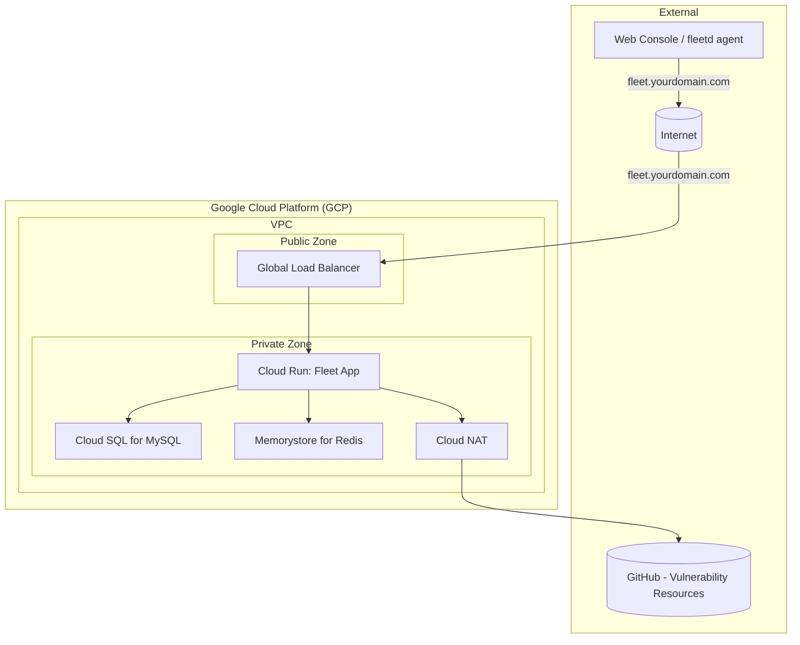

# Terraform Google Cloud Fleet Deployment

This Terraform project automates the deployment of Fleet Device Management (Fleet) on the Google Cloud Platform (GCP). By default it creates a new GCP project and deploys all necessary infrastructure components. To use an existing project instead, set `create_project = false` and provide a `project_id`.

## How to apply

**Run Terraform from this directory only** — the same place as `main.tf`, `variables.tf`, and `terraform.tfvars`.

```bash
terraform init
terraform plan
terraform apply
```

`byo-project/` is a **local module** (`source = "./byo-project"` in `main.tf`), not a separate root module. Do not `cd byo-project` and apply there — that layout does not work as a standalone stack with our wiring (root holds backend, provider, tfvars, and project selection).

It deploys:

*   A new GCP project (via `terraform-google-modules/project-factory`)
*   VPC Network and Subnets
*   Cloud NAT for outbound internet access
*   Cloud SQL for MySQL (database for Fleet)
*   Memorystore for Redis (caching for Fleet)
*   Google Cloud Storage (GCS) bucket (for Fleet software installers, S3-compatible access configured)
*   Google Secret Manager (for storing sensitive data like database passwords and Fleet server private key)
*   Cloud Run v2 Service (for the main Fleet application)
*   Cloud Run v2 Job (for database migrations)
*   External HTTP(S) Load Balancer with managed SSL certificate (unless you [bring your own load balancer](#bring-your-own-load-balancer-optional))
*   Cloud DNS for managing the Fleet endpoint
*   Appropriate IAM service accounts and permissions

## Prerequisites

1.  **Terraform:** Version `~> 1.11` (as specified in `main.tf`).
2.  **Google Cloud SDK (`gcloud`):** Installed and configured. Install from [cloud.google.com/sdk](https://cloud.google.com/sdk/docs/install).
3.  **Python 3** (standard library only) on the machine that runs Terraform, unless `fleet_config.exec_migration = false`. It runs the [database migration gate](#database-migration-gate).
4.  **GCP Account & Permissions:**
    *   Credentials configured for Terraform to interact with GCP. Run `gcloud auth application-default login`. The migration gate uses the same Application Default Credentials through `gcloud auth application-default print-access-token` at run time.
    *   The ADC identity must be able to update Cloud Run services and jobs, run jobs and read executions, tasks, revisions and operations (for example `roles/run.admin`), and read Cloud Monitoring time series (`roles/monitoring.viewer`). Project `Owner`/`Editor` include these.
    *   **New project** (`create_project = true`, the default): `Organization Administrator` or `Folder Creator` & `Project Creator` at the org/folder level, plus `Billing Account User` on the billing account.
    *   **Existing project** (`create_project = false`): `Owner` or `Editor` on the target project, plus `roles/dns.admin` if managing Cloud DNS.
5.  **Registered Domain Name:** You will need a domain name that you can manage DNS records for. This project will create a Cloud DNS Managed Zone for this domain (or a subdomain).
6.  **(Optional) Fleet License Key:** If you have a premium Fleet license, you can provide it via `fleet_config.license_key`.

### APIs in an existing project

New projects automatically enable the Fleet baseline APIs. For `create_project = false`, API management remains **off by default**. Either pre-enable the baseline listed in [`api-management.tf`](./api-management.tf), plus any APIs your optional configuration needs, or opt in:

```hcl
create_project               = false
project_id                   = "your-existing-project-id"
manage_existing_project_apis = true
extra_apis                   = [] # additional APIs beyond the Fleet baseline
```

With this opt-in, Terraform enables the same baseline as new projects plus `extra_apis`, and waits for those APIs before creating Fleet resources. The Terraform identity needs permission to enable services, such as `roles/serviceusage.serviceUsageAdmin`. Opting out later or destroying the stack **does not disable these APIs**. Without the opt-in, `extra_apis` does not manage APIs in an existing project; some child resources still enable their individual APIs: Redis (through the Memorystore module, and before the Memorystore CMEK grant when `cmek.redis` is set), KMS when any CMEK setting is enabled, and Cloud Run when `cmek.cloud_run` is set. These per-feature activations don't cover every Fleet prerequisite. Direct callers of `byo-project` must manage the remaining prerequisites themselves.

**Adopting API management on an existing deployment.** On a fresh deployment, the opt-in works in a single `terraform apply`. If you set `manage_existing_project_apis = true` on a Fleet stack that is **already deployed**, or later change the managed API set (for example, `extra_apis`), the module-wide `depends_on` on the API resources can defer data sources inside the Fleet module. The plan may then propose replacing KMS and Secret Manager IAM bindings. To avoid that, apply only the API resources first from this directory, then run a normal apply and review the full plan:

```bash
terraform apply -target='google_project_service.existing_project_apis'
terraform apply
```

If you call this stack from a wrapper module, prefix the full module path, for example `-target='module.<your_module_name>.google_project_service.existing_project_apis'`. Use `-target` only for this adoption or change step. It is not part of normal deployments or fresh provisioning.

## Configuration

1.  **Create a `terraform.tfvars` file** with at minimum:

    ```hcl
    billing_account_id = "012345-6789AB-CDEFGH"
    org_id             = "111122223333"  # or use folder_id instead
    dns_zone_name      = "gcp.example.com."
    dns_record_name    = "fleet.gcp.example.com."

    fleet_config = {
      image_tag              = "fleetdm/fleet:v4.93.0"
      fleet_cpu              = "1000m"
      fleet_memory           = "4096Mi"
      debug_logging          = false
      min_instance_count     = 1
      max_instance_count     = 5
      exec_migration         = true
      use_h2c                = false
      installers_bucket_name = "your-globally-unique-bucket-name"
      # license_key           = ""
    }
    ```

    To use an existing project instead, omit `billing_account_id` and `org_id` and set:
    ```hcl
    create_project = false
    project_id     = "your-existing-project-id"
    ```

2.  **Required variables** (no defaults — must be set):

    | Variable | Description |
    |---|---|
    | `billing_account_id` | GCP Billing Account ID. Required when `create_project = true` (the default). |
    | `org_id` or `folder_id` | Where to create the project. Required when `create_project = true`. |
    | `dns_zone_name` | DNS zone managed in Cloud DNS (e.g., `gcp.example.com.`). **Must end with a dot.** |
    | `dns_record_name` | FQDN for Fleet (e.g., `fleet.gcp.example.com.`). **Must end with a dot.** |
    | `fleet_config.installers_bucket_name` | GCS bucket name for software installers. Must be globally unique. |

    When `create_project = false`, set `project_id` instead of `billing_account_id` and `org_id`/`folder_id`.

    Review `variables.tf` and `byo-project/variables.tf` for all available options and their defaults.

## Bring your own load balancer (optional)

By default the module creates a global (or, with `use_regional_lb = true`, regional) external Application Load Balancer. To front Fleet with an Application Load Balancer you own instead, disable the module-managed one:

```hcl
load_balancer_config = {
  enable = false
}
```

* **Cloud Run ingress does not change.** The Fleet service keeps `ingress = "INGRESS_TRAFFIC_INTERNAL_LOAD_BALANCER"` (Cloud Run's "Internal and Cloud Load Balancing" setting). Disabling the module-managed load balancer does **not** expose Fleet at a public Cloud Run URL. The module creates no public endpoint, certificate, or DNS record in this mode, so devices and users can't reach Fleet until you connect your own load balancer.
* **Connect your load balancer to `serverless_neg_id`.** This output is the ID of the regional serverless network endpoint group (NEG) the module already creates for the Fleet Cloud Run service (`terraform output serverless_neg_id`). Add it as a backend of your load balancer's backend service. The output is set whether or not the module-managed load balancer is enabled. Use a load balancer type that supports serverless NEG backends; a regional load balancer must be in the same `region` as Fleet.
* **You own the rest of the load balancer:** frontend IP and forwarding rules, certificates, HTTP-to-HTTPS redirect, URL map, backend service, logging, and DNS. In this mode `fleet_application_url`, `load_balancer_ip_address`, and `regional_cert_dns_authorization_record` are `null`, and `load_balancer_type` is `"none"`. No DNS A record is created, even with `dns_config.enable = true`. Point your DNS record at your own load balancer's address.
* **Module-managed Cloud Armor is not available.** `cloud_armor.enable = true` requires the module-managed regional load balancer. If you need a Cloud Armor policy, attach your own to your backend service. The [path guidance](#choosing-public-paths) below still applies when you choose which paths to allow.

## Cloud Armor allowlist (optional)

`cloud_armor` attaches an optional Cloud Armor security policy to the load balancer. It is **off by default** (`cloud_armor.enable = false`), and when it is off nothing is created.

When enabled, the policy is an explicit allowlist that you own:

| Input | Effect |
|---|---|
| `allowed_ip_ranges` | Requests from these source IP addresses or CIDR ranges are allowed to **any path**. `*` matches every source, which allows all traffic. |
| `allow_public_paths` | Requests whose path matches one of these RE2 regular expressions are allowed from **any source**. |
| everything else | Denied with **HTTP 403**. |

* **No Fleet endpoints are allowed automatically.** The module never adds default paths or IP ranges. You decide what is reachable.
* Either list may be empty. An IP-only policy (only `allowed_ip_ranges`) is valid. Enabling the policy with **both** lists empty is rejected at plan time, because it would return 403 for every request.
* **IP-only policies block devices outside those ranges.** With no `allow_public_paths`, fleetd/osquery agents and MDM-enrolled devices can reach Fleet only if their traffic comes from a listed range (for example, a VPN or office egress). Devices anywhere else get 403, so enrollment, check-ins, and MDM commands fail for them.
* `allow_public_paths` entries are RE2 regexes matched against the request path. Anchor them with `^` so they only match the intended path prefix. Each regex is passed to Cloud Armor as an escaped CEL string literal, so quotes and backslashes are safe and keep their regex meaning. In HCL, write a regex backslash as `\\` (for example, `"^/api/v\\d+/"`).
* Rules are chunked to fit Cloud Armor limits: up to 5 path regexes per rule (priorities 1000, 1010, …) and up to 10 IP ranges per rule (priorities 2000, 2010, …). The deny-all rule is the policy's default rule at priority 2147483647.
* Only `tier = "STANDARD"` is implemented. `tier = "ENTERPRISE"` is rejected when the policy is enabled.
* **Plan-time validation.** When `cloud_armor.enable = true`, the root module and `byo-project` both reject invalid settings before anything is created. Each `allow_public_paths` entry must be a valid regular expression (checked with Terraform's `regexall`, which uses RE2 syntax). Each `allowed_ip_ranges` entry must be a valid IPv4 or IPv6 address (for example, `198.51.100.7` or `2001:db8::1`), a CIDR range (for example, `203.0.113.0/24` or `2001:db8::/32`), or `*`. Entries are passed to Cloud Armor exactly as you write them; bare addresses aren't rewritten to `/32` or `/128`. The module-managed regional load balancer must be enabled, and `tier` must be `"STANDARD"`. Passing these checks doesn't guarantee Cloud Armor accepts every expression, so review the plan and apply results.

### Choosing public paths

Which paths your devices need depends on the Fleet features you use (osquery/fleetd, Fleet Desktop, Apple/Windows/Android MDM, and so on). For the most up-to-date, feature-by-feature list of endpoints, see Fleet's guide [Which API endpoints to expose to the public internet?](https://fleetdm.com/guides/what-api-endpoints-to-expose-to-the-public-internet). The [examples below](#examples) translate that guide's list into feature groups. They are not exhaustive or version-locked: if they differ from the guide, follow the guide, and confirm the paths against the Fleet version you run. Nothing is allowed unless you add it.

* fleetd's update (TUF) repository is normally not served by this load balancer. By default, fleetd downloads updates from `updates.fleetdm.com` (or from your own TUF server), so TUF paths usually do not belong in this list.
* **Device routes and admin routes are different.** The guide's "Using fleetctl CLI from outside your network" entries (`/api/setup`, `/api/*/setup`, `/api/*/fleet/*`) cover the admin API, not device traffic. A public `^/api/[^/]+/fleet/` pattern would allow nearly the whole REST API, including admin endpoints, from any source, and would make most device-specific patterns redundant. Prefer `allowed_ip_ranges` for admins, the web UI, and `fleetctl`.

The examples convert the guide's wildcard paths into anchored RE2 patterns:

| Guide form | RE2 pattern | Meaning |
|---|---|---|
| Trailing `/*`, for example `/api/osquery/*` | `^/api/osquery/` | Any path under that prefix |
| `*` inside a path, for example `/api/*/fleet/...` | `^/api/[^/]+/fleet/...` | Exactly one path segment, such as an API version (`v1`, `latest`) or a device token |
| Exact endpoint, for example `/mdm/apple/mdm` | `^/mdm/apple/mdm$` | That path only. Cloud Armor's `request.path` excludes the query string |
| Both a path and its `/*` sub-paths | `^/mdm/apple/service_discovery(/\|$)` | The path itself and anything under it |
| A literal `.`, for example `/.well-known/...` | `^/\.well-known/...` | An escaped dot. Inside an HCL string, write it as `\\.` |

After enabling, check the load balancer logs for 403 responses from managed devices and adjust the list.

### Requirements and limitations

* **Regional load balancer only.** Cloud Armor is currently wired only for the regional external Application Load Balancer. `cloud_armor.enable = true` requires `load_balancer_config.enable = true` and `load_balancer_config.use_regional_lb = true`. The global load balancer path is not supported.
* **Native Terraform attachment.** The regional backend uses `google-beta`'s `security_policy` field. Attachment, detachment, and drift are tracked by Terraform; no `gcloud` command or separate CLI login is required. The policy's allow/deny rules are configured before attachment.
* **Upgrade before disabling an older draft policy.** If an existing deployment used the previous `null_resource`/`gcloud` attachment, first apply this version with Cloud Armor still enabled and its configuration unchanged. That records the native attachment and detach-before-delete ordering in state. Only on a subsequent apply should you disable Cloud Armor or destroy the deployment. The old provisioner is forgotten without running its detach command; skipping this intermediate upgrade can leave GCP refusing to delete a still-attached policy.

### Examples

IP-only: admins and devices must all come from the listed ranges.

```hcl
load_balancer_config = {
  use_regional_lb = true
}

cloud_armor = {
  enable            = true
  allowed_ip_ranges = ["203.0.113.0/24", "198.51.100.7/32"]
}
```

Admin IP ranges plus public device paths for common features. Groups marked optional or "only if" apply only when you use that feature. Remove the groups you don't use:

```hcl
load_balancer_config = {
  use_regional_lb = true
}

cloud_armor = {
  enable            = true
  allowed_ip_ranges = ["203.0.113.0/24"] # admins, web UI, fleetctl: any path from these sources

  # Feature groups from Fleet's "Which API endpoints to expose to the public
  # internet?" guide, which has the most up-to-date list. Not complete for every
  # feature: verify against your Fleet version and add the optional groups below
  # only if you use them.
  allow_public_paths = [
    # osquery/fleetd hosts outside your VPN or intranet
    "^/api/osquery/",
    "^/api/v1/osquery/",

    # Fleet Desktop
    "^/api/[^/]+/fleet/device/[^/]+/desktop$", # required for Fleet Desktop
    "^/api/fleet/orbit/",                      # full Fleet Desktop and scripts functionality
    "^/api/fleet/device/ping$",                # full Fleet Desktop and scripts functionality

    # End-user "My device" page (frontend, static assets, and device API)
    "^/device/",
    "^/assets/",
    "^/api/[^/]+/fleet/device/", # listed by the guide under macOS MDM; covers the Desktop pattern above

    # Apple (macOS) MDM, including SCEP
    "^/mdm/apple/scep$",       # SCEP certificate enrollment
    "^/mdm/apple/mdm$",        # MDM protocol
    "^/api/mdm/apple/enroll$", # automatic enrollment profiles

    # Apple ACME: only if you use Hardware Attestation
    "^/api/mdm/acme/",

    # Windows MDM
    "^/api/mdm/microsoft/management$",
    "^/api/mdm/microsoft/discovery$",
    "^/api/mdm/microsoft/policy$",
    "^/api/mdm/microsoft/enroll$",
    "^/api/mdm/microsoft/tos$", # required for automatic enrollment

    # Optional: only if using Fleet as a SCEP proxy with a configured SCEP server
    "^/mdm/scep/proxy/",
  ]
}
```

Optional groups. Append these to `allow_public_paths` only for the features you use:

| Feature (when needed) | Patterns |
|---|---|
| macOS setup: end-user IdP authentication (SSO) | `"^/mdm/sso$"`, `"^/api/[^/]+/fleet/mdm/sso$"`, `"^/mdm/sso/callback$"`, `"^/api/[^/]+/fleet/mdm/sso/callback$"`, `"^/assets/"` |
| macOS setup: EULA | `"^/api/[^/]+/fleet/mdm/setup/eula/"` |
| macOS setup: bootstrap package | `"^/api/[^/]+/fleet/mdm/bootstrap$"` |
| macOS Platform SSO (Fleet's extension) | `"^/api/mdm/apple/psso/"`, `"^/\\.well-known/apple-app-site-association$"` |
| iOS/iPadOS enrollment page and profile | `"^/enroll$"`, `"^/api/[^/]+/fleet/enrollment_profiles/ota$"` |
| iOS/iPadOS in-house (`.ipa`) apps | `"^/api/[^/]+/fleet/software/titles/[^/]+/in_house_app$"` |
| iOS/iPadOS account-driven User Enrollment (BYOD) | `"^/api/mdm/apple/account_driven_enroll(/\|$)"`, `"^/mdm/apple/account_driven_enroll/sso(/\|$)"`, `"^/mdm/apple/service_discovery(/\|$)"` |
| Android enrollment page and Android Enterprise | `"^/enroll$"`, `"^/api/[^/]+/fleet/android_enterprise/enrollment_token$"`, `"^/api/[^/]+/fleet/android_enterprise/pubsub$"` |
| Android Wi-Fi/VPN certificate deployment | `"^/api/fleetd/"` |

The guide also covers mTLS for some device endpoints (its "Advanced" section). Cloud Armor path allowlisting does not replace Fleet's endpoint authentication.

## Customer-managed encryption (CMEK)

CMEK uses Google Cloud KMS keys for encryption at rest, analogous to AWS KMS customer-managed keys. All new service options below are **unset/off by default**, independently of the existing GCS setting. Setting `cmek.enable = true` still enables **GCS-only** encryption; it does not opt existing databases, caches, services, or secrets into new encryption changes.

| Configuration | Scope | Required key location | Existing-resource consequence |
|---|---|---|---|
| `enable`, `create_kms`, `kms_key_ring`, `kms_crypto_key` | Existing GCS bucket encryption configuration; optionally creates its key | `location`, matching the bucket | Existing objects are not retroactively re-encrypted |
| `cloud_sql.kms_key_id` | Cloud SQL instance | `region` | **Instance replacement**; migrate/back up data before enabling |
| `redis.kms_key_id` | Memorystore Redis instance | `region` | **Instance replacement** |
| `cloud_run.kms_key_id` | Fleet service and migration job | `region` | Service revision/job template update |
| `secret_manager.kms_key_id` | Managed secrets with automatic replication | `global` | **Managed secret replacement** with the same IDs under the pinned provider |
| `secret_manager.replica_kms_key_ids` | Managed secrets with `replicate_secrets` set | One key in each replica's region | **Managed secret replacement** with the same IDs under the pinned provider |

The new consumers accept **full key IDs** for keys provisioned separately or by the caller's Terraform configuration; they do not create additional keys. The deployer must be allowed to grant key access to each service's Google-managed service agent. API enablement is a prerequisite, particularly for existing projects; use the opt-in above or pre-enable the required services. A regional key cannot be replaced by the default multi-region GCS key, and a global Secret Manager key cannot be used for a regional service.

**IAM propagation wait.** When any of `cmek.cloud_sql`, `cmek.redis`, `cmek.cloud_run`, or `cmek.secret_manager` is set, Terraform waits `cmek_iam_propagation_delay_seconds` (default `120`) after granting the service agents access to their keys and before creating the resources that use them. Google notes that IAM access changes [typically take about 2 minutes to propagate, and sometimes 7 minutes or longer](https://docs.cloud.google.com/iam/docs/access-change-propagation). Set it to a non-negative integer; `0` skips the wait. The wait is not a guarantee. If propagation takes longer, an apply can still fail, and you can re-run `terraform apply` after a few minutes. Don't assume every failure is a propagation delay: permission-denied errors that persist, or key location/region errors, point to a configuration problem (a missing grant permission, the wrong key, or a key in the wrong location) and won't resolve by waiting. The legacy GCS-only setting (`cmek.enable`) and the default configuration without CMEK don't wait.

**When the wait runs again.** The wait happens when it is first created, and again only when it is replaced: when an opted-in grant's key, role or member changes, or when a per-service CMEK consumer is added or removed. Changing only `cmek_iam_propagation_delay_seconds` updates the stored duration in place without waiting; the new value applies the next time the wait is created or replaced. Not every apply waits.

For example, for an encrypted fresh provision using existing keys and regional secret replication:

```hcl
region            = "us-central1"
replicate_secrets = ["us-central1"]

cmek = {
  # GCS remains separately opt-in through enable/kms_key_ring/kms_crypto_key.
  cloud_sql = {
    kms_key_id = "projects/YOUR_PROJECT_ID/locations/us-central1/keyRings/fleet/cryptoKeys/database"
  }
  redis = {
    kms_key_id = "projects/YOUR_PROJECT_ID/locations/us-central1/keyRings/fleet/cryptoKeys/cache"
  }
  cloud_run = {
    kms_key_id = "projects/YOUR_PROJECT_ID/locations/us-central1/keyRings/fleet/cryptoKeys/run"
  }
  secret_manager = {
    replica_kms_key_ids = {
      us-central1 = "projects/YOUR_PROJECT_ID/locations/us-central1/keyRings/fleet/cryptoKeys/secrets"
    }
  }
}
```

With automatic replication (`replicate_secrets = []`), use `secret_manager = { kms_key_id = "projects/YOUR_PROJECT_ID/locations/global/keyRings/fleet/cryptoKeys/secrets" }` instead. Regional replication requires a key for every configured replica; the module does not silently leave any managed replica unencrypted. External private-key secrets and `extra_secret_env_vars` remain caller-managed and are not modified by this configuration.

**Review the plan before upgrading.** Opting an existing SQL or Redis instance into CMEK is not a safe in-place migration. Changing managed-secret replication encryption replaces those secrets under the pinned provider and recreates current values from Terraform; historical versions are not preserved by that replacement. Back up required versions before making this change. These settings do not enable database/Redis TLS, create an Artifact Registry repository, certify compliance, or bypass organization policies. The Cloud Run invoker still uses an `allUsers` IAM member, which restrictive domain policies may reject. Use a compatible image supplied through `fleet_config.image_tag`; validate the image and encryption configuration in your target GCP environment.

## Installer-bucket versioning and retention

Versioning is optional and **off by default**, matching the AWS Terraform modules. The existing bucket name remains `fleet_config.installers_bucket_name`.

```hcl
software_installers_config = {
  enable_bucket_versioning           = true
  expire_noncurrent_versions         = true # opt out with false
  noncurrent_version_expiration_days = 30
}
```

When versioning is enabled, noncurrent-version expiry defaults on after 30 days. The lifecycle targets **archived/noncurrent versions only**, never the live installer object. Disable expiry to retain all versions indefinitely. With versioning off, this module adds no expiry rule. Enabling expiry on an existing versioned bucket can delete versions already older than the configured window; `allow_destroy` does not prevent lifecycle expiry. Applying the new default to a previously versioned draft deployment suspends versioning without deleting its retained versions.

## Database migration gate

With `fleet_config.exec_migration = true` (the default), Terraform runs the Fleet database migration (`fleet prepare db` in the `fleet-migration` Cloud Run job) through a controller, [`byo-project/scripts/fleet_migration_gate.py`](./byo-project/scripts/fleet_migration_gate.py), on the machine running Terraform. The controller runs before Terraform updates the Fleet service. It runs on the first apply that includes it (initial setup, or the first apply after upgrading this module). It runs again whenever one of these changes:

* `fleet_config.image_tag`.
* The project, region, service or job identity.
* The target database:
  * Terraform creates or replaces the Cloud SQL instance. This includes a replacement that keeps the same instance name and image, for example a ForceNew change such as opting into `cmek.cloud_sql`.
  * `database_config.database_name` changes. The migration then prepares the newly created logical database.

It does not re-run for other job, service or database changes, for example CPU, memory, scaling, SQL tier, labels, IAM, load balancer, Redis or extra environment variables. It also runs again on the apply after any failed run (see **Retrying after a failure** below).

**The gate does not replace, back up or restore the database.** It never creates, replaces or restores Cloud SQL. Terraform performs any instance replacement shown in the plan before the gate runs, so the gate cannot keep Fleet stopped during the replacement itself. `fleet prepare db` creates or upgrades the schema of the target database. It does not copy or restore existing Fleet data. A replaced instance or a new database name starts empty. Back up first, and restore data yourself, if you replace the database on purpose.

The contract is that no Fleet server, background or vulnerability processing runs while the migration runs. Only the migration job runs; Cloud SQL and Redis stay up. A minimum instance count of 0 is not treated as stopped. For an existing service, the controller does the following:

1. **Read-only preflight.** Checks the service, the job, every job execution, and every revision (including soft-deleted ones). Refuses without changing anything if the service is reconciling or failed, traffic is not a single untagged 100% `LATEST` target, any traffic tag exists, or the job is not single-task, single-attempt (`task_count = 1`, `parallelism = 1`, `max_retries = 0`) and on the target image. The execution listing is cross-checked with the job's `latestCreatedExecution`. If an execution is still running, or the job reports an execution that the listing does not show yet, the controller waits read-only, up to the job's task timeout plus 15 minutes; it never treats that as "nothing is running", and if the wait runs out it fails without changing anything. Also refuses if Cloud Monitoring has no recent `run.googleapis.com/container/instance_count` data for every revision. That check only predicts whether the proof below can succeed; it is not evidence of zero.
2. **Claim.** One etag-guarded update writes this run's ownership record to the `fleetdm.com/migration-gate` annotation on the job. The controller reads the job back and requires a new etag. It uses that etag for `:run`, so a `:run` that an earlier, interrupted controller prepared with an older etag no longer matches. The execution inventory is read again and must be settled.
3. **Stop.** One etag-guarded update sets service scaling to `MANUAL` with `manualInstanceCount = 0` and `minInstanceCount = 0`. The same write records the pre-migration scaling and the run phase in the `fleetdm.com/migration-gate` service annotation. The record contains no secrets.
4. **Verified actual zero.** Reads raw, unaggregated `instance_count` points (every page) and waits until every revision has an explicit `active = 0` and `idle = 0` point at the same timestamp. That covers every revision from the full revision list and every revision in the telemetry. The point must be after the stop (HTTP `Date` + 1 s) and no later than the server time Google already reported. Missing, partial, stale, future-dated, non-zero or erroring telemetry blocks the migration. The gate gives up after 20 minutes.
5. **Migration.** At most one `:run` per apply, sent only after the job is read again exactly as claimed (record, generation and etag) and the complete execution inventory is listed again. The `:run` is guarded by the claimed job etag and never retried within the apply. Success requires the operation, the execution counts and conditions, and the single task (completed, a successful attempt with exit code and termination signal both zero, including documented ProtoJSON default zeros within a present result, not retried) to all verify. Cloud Run can omit a task `uid`, so the task is identified by its resource name, which must be a single task ID directly under the gate's own execution, and by its `execution` and `job` fields, which must name that execution and the migration job. The execution itself is identified by the `:run` operation, its `uid`, the pinned job generation, the job's execution inventory and `latestCreatedExecution`. The execution and task images must be the configured image or Google's digest resolution of it (see **Image identity** below). Any other execution, a change to the service or job, or a loss of this run's ownership record makes the outcome uncertain.
6. **Resume.** While still `MANUAL`/0, deploys the target image together with the serving environment (plain values and Secret Manager references, including the MySQL and Redis addresses) and the Cloud Run CMEK key. These are copied from the migration job, which Terraform builds from the same settings as the service and updates first. The job's command, arguments, timeout and retries are never copied, and ports, probes and other service settings are kept. Google names the new revision. The gate waits for a new Ready revision that runs exactly that configuration and serves 100% with no tags, then restores the recorded pre-migration scaling. If the service already runs that configuration on a Ready latest revision (for example, on the first apply after upgrading this module with an unchanged image), no new revision is created; the current Ready revision is verified instead. If the template already matches but its latest revision failed or never became Ready (an earlier rollout failed), the same template is deployed again under a fresh, explicit revision name derived from the run (`<service>-g<10 hex digits>`, checked against every existing revision name), so a genuinely new revision is created. The job and its executions are re-checked before and throughout this step. Terraform then applies the remaining service changes (for example resources or probes). A previous image version is not restored when it differs from the target image. If no matching Ready revision appears under `MANUAL`/0, the gate does not restore scaling.

For a fresh deployment (no service yet), the controller runs the migration only after confirming three things: no service with that name exists, including soft-deleted ones; Cloud Monitoring shows no recent instances; and every job execution has settled (with the same bounded wait and `latestCreatedExecution` cross-check). A 404 alone is not treated as proof. Every entry in the region's service listing must have a well-formed name; an entry it cannot identify blocks the bootstrap. A `fleet-api` entry blocks it whether the project is spelled as the project ID or the project number. Ownership is claimed on the job annotation (etag-guarded), the absence proof is repeated right before `:run`, and Terraform creates the service only after the migration is verified and the record is completed. Every bootstrap run proves absence again and runs one fresh migration. An earlier record never blocks this and is never taken as proof that the migration already ran, whether it is unfinished or completed, and even if its execution list no longer matches.

**Failure behavior.** Any failure, timeout or unknown makes `terraform apply` fail before Terraform updates the service. A preflight rejection leaves the service unchanged and starts no new migration. After stopping, an unverified migration never permits restoration of scaling. If a restore write has an uncertain outcome, the controller attempts to disable restarts again, but only while the service still carries this run's own record; it cannot promise shutdown when the control plane cannot confirm it. The controller reports the state it last verified:

* "restart disabled" means the `MANUAL`/0 setting was read back but no current complete zero measurement exists.
* "stopped" means a complete measured zero was verified and the service is unchanged since.
* "unknown" means it could not verify either.

It also reports whether the migration did not run, failed, succeeded, or has an unknown outcome.

**Retrying after a failure.** Fix the underlying cause, for example the database, the configuration or a Google API problem, then run `terraform apply` again. A failed gate run taints its Terraform resource, so the next apply runs the gate again under a new run ID. The `fleetdm.com/migration-gate` annotation is internal state that the gate writes and reads, not a lock. Do not edit or remove it, and do not change scaling, deploy images or run the migration job by hand to "finish" a run. On the next apply the controller:

* keeps the pre-migration scaling recorded by the run that first stopped Fleet, across any number of failed applies, and never derives it from the current `MANUAL`/0 setting;
* waits, read-only and bounded, for any execution that may still be running, for example one whose `:run` response was lost, and never starts a migration while earlier work is running or not consistently visible. If the wait runs out it fails without changing anything, and a later apply checks again;
* claims the job and the service under its own run ID, which fences writes from an earlier controller (see **Trust boundary and limits**);
* proves zero again after its own claim. For a service that is already stopped, missing recent telemetry before the claim does not block the attempt, but the post-claim zero proof is still required. Without it the apply fails without running a migration, and a later apply tries again;
* runs at most one fresh migration (`fleet prepare db` is idempotent) against the current job configuration, so a changed image or database between applies is picked up;
* resumes Fleet only after that migration and a matching Ready revision are verified. For a failed earlier rollout this happens with a new revision (see step 6 above).

The controller never restarts the old image after a partial migration, never repairs or rolls back the database, and never guesses scaling. Some failures need a fix to the underlying state before a re-apply can succeed: a database problem that makes `fleet prepare db` fail, a service that is `MANUAL`/0 without a valid record written by this gate (its original scaling is unknown, so the gate refuses), or a Ready revision whose runtime image contradicts its template (see **Image identity**). After such a fix, a plain `terraform apply` is all that is needed.

**Trust boundary and limits.**

* The gate relies on Google's documented behavior:
  * `MANUAL` scaling with 0 instances accepts no requests and starts no instances.
  * `instance_count` is the number of container instances that exist.
  * List and Monitoring responses are complete when they report no errors.
  * Conditional writes and `:run` with an `etag` are rejected when the etag is stale.
* It assumes no other person, pipeline or controller changes the Fleet service or job, or runs the job, while it runs. Etag checks, the ownership records and the Terraform state lock detect or prevent ordinary concurrent writers. They do not protect against a malicious administrator or a platform defect.
* Fencing an earlier, interrupted controller is an engineering safeguard built on documented behavior, not a published Google guarantee. The guaranteed control is that each apply sends at most one fresh `:run`, with the etag it read back after its own claim. A `:run` prepared with an older etag is expected to be rejected. Google does not document how atomic `:run` is, how quickly executions become visible in the listing and in `latestCreatedExecution`, or whether output-only changes alter the job etag. So an execution that an earlier request started is detected only once the listing or `latestCreatedExecution` shows it. Anything visible, inconsistent or unknown makes the run wait or fail, and a later apply checks again. Every gate write that could overwrite a successor (phase writes, the re-stop, the bootstrap completion) is sent with the etag of a read that still shows that run's own record in the expected phase.
* Whether Google publishes fresh explicit zero points for revisions with no instances (for example, older revisions, a failed revision, or a service stopped for a long time) is **not verified**. If it does not, the gate refuses: in the read-only preflight when a running service has no recent data, otherwise after stopping. A service with retained older revisions may then be unable to upgrade through the gate until those revisions are deleted and no longer listed. Plan for a maintenance window, and test an upgrade in a non-production project first.
* New-revision readiness under `MANUAL`/0 has not been verified against a live deployment. If it cannot be confirmed, scaling is not restored.
* The explicit revision name used to redeploy an unchanged template after a failed rollout is a documented optional field (`RevisionTemplate.revision`). The module leaves it unset (`revision = null`), and in the `google` provider it is optional and not computed. The next plan may therefore propose clearing it, which deploys one more revision with the same configuration. Whether this happens has not been verified against a live deployment; review the plan after such a recovery.
* Other identity checks compare Cloud Run resource names with the configured project ID. If the API reported names using the project number instead, the gate would refuse in its read-only preflight, without stopping Fleet. A short `latestCreatedExecution` name is read as an execution of the migration job.
* Do not bypass the gate with `-target` on the service.
* `exec_migration = false` removes the gate. Image changes then roll out without any migration; run migrations yourself. It is not a recovery step: while Fleet is stopped by the gate, keep the gate enabled and re-apply. Disabling it removes the dependency that keeps Terraform from changing the service before a verified migration.
* **Image identity.** The job and service *configuration* must carry the exact configured `fleet_config.image_tag` string; the gate never writes a resolved digest into the service template, so Terraform does not later revert it to the tag. The objects Cloud Run creates from that configuration (the migration execution, its task, and the serving revision) may report the image as Google resolved it. For example, `fleetdm/fleet:v4.93.0` is reported as `mirror.gcr.io/fleetdm/fleet@sha256:...`. Such a runtime image is accepted only when all of these hold:
  * It names the same canonical repository. Docker Hub shorthand and the exact hosts `docker.io`, `index.docker.io`, `registry-1.docker.io` and `mirror.gcr.io` are treated as Docker Hub. Any other registry, for example Artifact Registry, must match host and path exactly. `gcr.io` and look-alike hosts are not Docker Hub.
  * It carries either the configured tag or a `sha256` digest (64 lowercase hex digits). A digest must equal the configured digest, if `image_tag` includes one, and a tag it shows must not contradict the configured tag.
  * Every digest reported in the run is the same. The first one reported (normally by the migration execution) is pinned, and the task and the serving revision must agree with any digest they report. The gate's own execution is checked on every poll while it runs, at completion, and on every later re-check before and during the rollout, including any copy of it embedded in the `:run` operation's metadata or response. Executions of earlier runs are never used as evidence for the current run.

  The gate does not query any registry and does not independently attest the digest. It trusts Google's tag-to-digest resolution only for its own single execution of the exact configured, generation-pinned job (and that execution's task), and for the Ready revision of a service template that matches the configured image exactly. If the execution and the task report different digests (for example, a multi-architecture index digest versus a platform manifest digest), the gate does not try to map one to the other. The migration outcome is reported as unknown and Fleet stays stopped until a later apply verifies a fresh migration. If the task or the revision reports only the configured tag, it is accepted on the assumption that the tag is immutable. Cloud Run can report the task image this way (the configured tag) even when the execution reports the digest. If the configured image pins a digest, every runtime image must report that digest. If a Ready revision of the matching template reports a different image or digest (for example, a mutable tag that now resolves differently), retries keep failing on that revision; the gate does not redeploy it. Change `image_tag` to an immutable tag or a digest and apply.
* Use an immutable image tag, or pin a digest in `image_tag` (`repository:tag@sha256:...` or `repository@sha256:...`). With a mutable tag, the migration job and the serving revision can run different binaries whenever Cloud Run reports only the tag.
* Replacement detection uses the instance's `connection_name`, which only the provider sets. For a planned replacement, Terraform plans that value as unknown, and so replaces the gate's Terraform resource. This was checked against the source of Terraform 1.12.0 and 1.14.5 and of `google-beta` 6.35.0 and 6.50.0, the provider the `sql-db` 25.x module uses for the instance. It has not been verified with a live replacement.
* When an instance is replaced and keeps the same name, the `sql-db` module does not plan new database and user resources in that apply, because they reference the instance only by name. The migration is then expected to fail, and Fleet stays stopped. The next `terraform apply` refreshes the database and user, plans them, and creates them before the gate runs again (the gate depends on the `sql-db` module). The gate then retries automatically with the original scaling.
* Recreating a logical database or user without changing the instance identity or database name is not detected: neither resource's creation identity is a module output. This includes out-of-band changes or explicitly replacing those individual Terraform resources. To request a fully gated migration in that case, use `terraform apply -replace='module.fleet.terraform_data.fleet_migration_gate[0]'` (adjust the module path if you call `byo-project` directly). It runs the same gate, which continues from any unfinished earlier run automatically.

## Upgrade notes

* Legacy project creation remains the default. Keep `create_project = true` for projects managed by this module; do not switch to the existing-project path as a shortcut, because removing project-factory ownership can affect the project and its services.
* The database default remains `fleet-mysql`. If a draft deployment was created with `fleet-mysql-v2`, explicitly retain that name in `database_config` before upgrading, or Terraform will propose replacement.
* The regional load balancer now shares one reserved IP for HTTP and HTTPS, regardless of `create_static_ip`. Previously ephemeral draft deployments may change IP; update external DNS and review the plan.
* The `google-beta` provider is now configured with `default_labels = var.labels`, matching the `google` provider. Existing resources managed through `google-beta` that support provider default labels may show in-place label updates on the first plan after upgrading. This is not a no-diff upgrade; review the plan.
* The installer bucket previously used `force_destroy = true`. It now follows `allow_destroy`, which defaults to `false`, so the plan shows an in-place `force_destroy` change. After upgrading, destroying a non-empty installer bucket fails unless you intentionally set `allow_destroy = true` and apply it first (see [Cleaning Up](#cleaning-up)). This guard is intended; keep `allow_destroy = false` outside teardown.
* Duplicate regional invoker ownership and the unused packages mirror are forgotten without remote deletion. New deployments no longer create the mirror. Operators retaining an old mirror must manage it separately.
* The migration job is no longer started by a `terracurl_request` with a plan-time access token. That resource is removed from state without being destroyed, so no destroy request is sent. The new [database migration gate](#database-migration-gate) runs on the first apply after upgrading, even if the image is unchanged, so Fleet stops briefly. It refuses before stopping Fleet if its preconditions or telemetry coverage are not met. The machine running Terraform now needs Python 3 and `gcloud` ADC. The migration job is now set to one task, one attempt (`max_retries = 0`).
* `create_static_ip` is an unsupported legacy input with no effect on either load balancer path: the regional load balancer always reserves one shared address, and the global load balancer's `lb-http` module creates its global address by default.
* `backend_timeout_sec` is an unsupported legacy input: serverless NEG backends do not accept a configurable backend timeout. The Fleet Cloud Run service timeout remains 300 seconds; this input does not change it.
* An enabled module-managed load balancer, global or regional, now requires `load_balancer_config.create_managed_cert = true` regardless of `https_redirect`. Configurations that previously set `create_managed_cert = false` with an enabled load balancer, including the HTTP-only regional setup with `https_redirect = false`, now fail at plan time. Set `create_managed_cert = true` and review the plan for the new certificate and listener changes, or set `load_balancer_config.enable = false` and use your own load balancer.

## Known Limitations

1. To handle large uploads, we need to bypass GCP Cloud Run's 32MB HTTP/1 body limit by setting `fleet_config.use_h2c = true`, which forces Fleet to use HTTP/2. However, as Cloud Run documentation notes, HTTP/2 end-to-end breaks connection upgrades, affecting WebSocket support and Fleet functionality for features such as Live Queries.

    **Workaround**: [Use Fleet GitOps Flow](https://fleetdm.com/docs/using-fleet/gitops#managing-software-installers)
    * Set `fleet_config.use_h2c = false` to force HTTP/1.
    * If you have large uploads, use `fleetctl apply` with a `url` field in your software YAML. The data flow avoids the ingress limit:
        * Apply the YAML (small request).
        * The Fleet Server makes an outbound GET request to download the file from the URL (S3, GCS, etc).
        * Cloud Run doesn't apply the 32MB limit to outbound requests.

## Deployment Steps

All commands below are run from this directory, not from `byo-project/`.

1.  **Authenticate with GCP:**
    ```bash
    gcloud auth application-default login
    ```

2.  **Initialize:**
    ```bash
    terraform init
    ```

3.  **Plan the Deployment:**
    ```bash
    terraform plan
    ```

4.  **Apply the Configuration:**
    ```bash
    terraform apply
    ```
    Initial provisioning can take 10–20 minutes, primarily due to Cloud SQL instance creation and API enablement.

5.  **Update DNS (if not using Cloud DNS for the parent zone):**
    If `dns_zone_name` (e.g., `gcp.example.com.`) is a new zone created by this Terraform, and your parent domain (e.g., `example.com.`) is managed elsewhere (e.g., GoDaddy, Cloudflare), you need to delegate this new zone.
    *   Get the Name Servers (NS) records for the newly created `google_dns_managed_zone`:
        ```bash
        terraform output dns_managed_zone_name_servers
        ```
    *   Add these NS records to your parent domain's DNS settings at your registrar or DNS provider.

    **If you disabled Cloud DNS (`dns_config.enable = false`):** Manually create an A record in your DNS provider pointing to the load balancer IP output by `terraform output load_balancer_ip_address`.

## Accessing Fleet

Once the deployment is complete, migrations have run successfully, and DNS has propagated:

*   Navigate to the `dns_record_name` you configured (e.g., `https://fleet.gcp.example.com`).
*   You should be greeted by the Fleet setup page or login screen.

## Key Resources Created (within the `byo-project` module)

*   **VPC Network (`fleet-network`):** Custom network for Fleet resources.
*   **Subnet (`fleet-subnet`):** Subnetwork within the VPC.
*   **Cloud Router & NAT:** For outbound internet access from Cloud Run and other private resources.
*   **Cloud SQL for MySQL (`fleet-mysql`):** Managed MySQL database.
*   **Memorystore for Redis (`fleet-cache`):** Managed Redis instance.
*   **GCS Bucket:** For S3-compatible software installer storage.
*   **Secret Manager Secrets:** Database password, Fleet server private key, and HMAC key for GCS access.
*   **Service Account (`fleet-run-sa`):** Used by Cloud Run services/jobs with necessary permissions.
*   **Cloud Run Service:** Hosts the main Fleet application.
*   **Cloud Run Job:** Runs database migrations.
*   **External HTTP(S) Load Balancer:** Provides public HTTPS access to Fleet. Not created with `load_balancer_config.enable = false`; see [Bring your own load balancer](#bring-your-own-load-balancer-optional).
*   **Cloud DNS Managed Zone:** Manages DNS records for `dns_zone_name`.
*   **DNS A Record:** Points `dns_record_name` to the load balancer IP.

## Cleaning Up

To destroy all resources:

```bash
allow_destroy = true   # set in terraform.tfvars first
terraform apply        # apply the protection removal
terraform destroy      # then destroy
```

Setting `allow_destroy = true` disables Cloud SQL's Terraform deletion protection and allows deletion of objects in non-empty GCS buckets during destroy. Apply that change before destroying. It does not control KMS protection: key rings/key names remain reserved by GCP, and managed key versions have a destruction window (30 days by default). With `allow_destroy = false`, an unprotected database or an empty bucket may still be destroyed; this is not a universal destroy guard.

## Important Considerations

*   **Permissions:** The user or service account running Terraform needs extensive permissions, especially for project creation. For ongoing management within the project, `Project Editor` or more granular roles generally suffice.
*   **Fleet Configuration:** This Terraform setup provisions the infrastructure. Further Fleet application configuration (e.g., SSO, SMTP, agent options) is done through the Fleet UI or API after deployment.
*   **Security:**
    *   Review IAM permissions granted.
    *   An enabled module-managed load balancer, global or regional, always requires `load_balancer_config.create_managed_cert = true`, whatever `https_redirect` is set to. `create_managed_cert = false` is rejected at plan time; there is no HTTP-only configuration. With the default `https_redirect = true`, HTTP requests are redirected to HTTPS. This check doesn't apply with `load_balancer_config.enable = false`, where your own load balancer handles certificates.
    *   Cloud SQL and Memorystore are not publicly accessible and connect via Private Service Access.
*   **Scalability:** Cloud Run scaling (`min_instance_count`, `max_instance_count`) and database/cache tier can be adjusted via `fleet_config`, `database_config`, and `cache_config`.

### Networking Diagram
