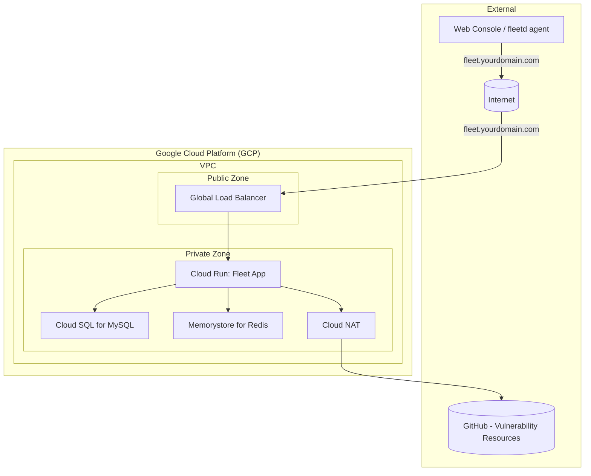

<!-- BEGIN_TF_DOCS -->
# Terraform Google Cloud Fleet Deployment

This Terraform project automates the deployment of Fleet Device Management (Fleet) on the Google Cloud Platform (GCP). By default it creates a new GCP project and deploys all necessary infrastructure components. To use an existing project instead, set `create_project = false` and provide a `project_id`.

## How to apply

**Run Terraform from this directory only** — the same place as `main.tf`, `variables.tf`, and `terraform.tfvars`.

```bash
terraform init
terraform plan
terraform apply
```

`byo-project/` is a **local module** (`source = "./byo-project"` in `main.tf`), not a separate root module. Do not `cd byo-project` and apply there — that layout does not work as a standalone stack with our wiring (root holds backend, provider, tfvars, and project selection).

It deploys:

*   A new GCP project (via `terraform-google-modules/project-factory`)
*   VPC Network and Subnets
*   Cloud NAT for outbound internet access
*   Cloud SQL for MySQL (database for Fleet)
*   Memorystore for Redis (caching for Fleet)
*   Google Cloud Storage (GCS) bucket (for Fleet software installers, S3-compatible access configured)
*   Google Secret Manager (for storing sensitive data like database passwords and Fleet server private key)
*   Cloud Run v2 Service (for the main Fleet application)
*   Cloud Run v2 Job (for database migrations)
*   External HTTP(S) Load Balancer with managed SSL certificate (unless you [bring your own load balancer](#bring-your-own-load-balancer-optional))
*   Cloud DNS for managing the Fleet endpoint
*   Appropriate IAM service accounts and permissions

## Prerequisites

1.  **Terraform:** Version `~> 1.12` (as specified in `main.tf`).
2.  **Google Cloud SDK (`gcloud`):** Installed and configured. Install from [cloud.google.com/sdk](https://cloud.google.com/sdk/docs/install).
3.  **GCP Account & Permissions:**
    *   Credentials configured for Terraform to interact with GCP. Run `gcloud auth application-default login`.
    *   The Terraform identity must be able to manage Cloud Run services and jobs (for example `roles/run.admin`). With `fleet_config.exec_migration = true`, Terraform also reads the Fleet service and the region's Cloud Run jobs (see [Database migration gate](#database-migration-gate)). Project `Owner`/`Editor` include these.
    *   **New project** (`create_project = true`, the default): `Organization Administrator` or `Folder Creator` & `Project Creator` at the org/folder level, plus `Billing Account User` on the billing account.
    *   **Existing project** (`create_project = false`): `Owner` or `Editor` on the target project, plus `roles/dns.admin` if managing Cloud DNS.
4.  **Registered Domain Name:** You will need a domain name that you can manage DNS records for. This project will create a Cloud DNS Managed Zone for this domain (or a subdomain).
5.  **(Optional) Fleet License Key:** If you have a premium Fleet license, you can provide it via `fleet_config.license_key`.

### APIs in an existing project

New projects automatically enable the Fleet baseline APIs. For `create_project = false`, API management remains **off by default**. Either pre-enable the baseline listed in [`api-management.tf`](./api-management.tf), plus any APIs your optional configuration needs, or opt in:

```hcl
create_project               = false
project_id                   = "your-existing-project-id"
manage_existing_project_apis = true
extra_apis                   = [] # additional APIs beyond the Fleet baseline
```

With this opt-in, Terraform enables the same baseline as new projects plus `extra_apis`, and waits for those APIs before creating Fleet resources. The Terraform identity needs permission to enable services, such as `roles/serviceusage.serviceUsageAdmin`. Opting out later or destroying the stack **does not disable these APIs**. Without the opt-in, `extra_apis` does not manage APIs in an existing project; some child resources still enable their individual APIs: Redis (through the Memorystore module, and before the Memorystore CMEK grant when `cmek.redis` is set), KMS when any CMEK setting is enabled, and Cloud Run when `cmek.cloud_run` is set. These per-feature activations don't cover every Fleet prerequisite. Direct callers of `byo-project` must manage the remaining prerequisites themselves.

**Adopting API management on an existing deployment.** On a fresh deployment, the opt-in works in a single `terraform apply`. If you set `manage_existing_project_apis = true` on a Fleet stack that is **already deployed**, or later change the managed API set (for example, `extra_apis`), the module-wide `depends_on` on the API resources can defer data sources inside the Fleet module. The plan may then propose replacing KMS and Secret Manager IAM bindings. To avoid that, apply only the API resources first from this directory, then run a normal apply and review the full plan:

```bash
terraform apply -target='google_project_service.existing_project_apis'
terraform apply
```

If you call this stack from a wrapper module, prefix the full module path, for example `-target='module.<your_module_name>.google_project_service.existing_project_apis'`. Use `-target` only for this adoption or change step. It is not part of normal deployments or fresh provisioning.

## Configuration

1.  **Create a `terraform.tfvars` file** with at minimum:

    ```hcl
    billing_account_id = "012345-6789AB-CDEFGH"
    org_id             = "111122223333"  # or use folder_id instead
    dns_zone_name      = "gcp.example.com."
    dns_record_name    = "fleet.gcp.example.com."

    fleet_config = {
      image_tag              = "fleetdm/fleet:v4.94.1"
      fleet_cpu              = "1000m"
      fleet_memory           = "4096Mi"
      debug_logging          = false
      min_instance_count     = 1
      max_instance_count     = 5
      exec_migration         = true
      use_h2c                = false
      installers_bucket_name = "your-globally-unique-bucket-name"
      # license_key           = ""
    }
    ```

    To use an existing project instead, omit `billing_account_id` and `org_id` and set:
    ```hcl
    create_project = false
    project_id     = "your-existing-project-id"
    ```

2.  **Required variables** (no defaults — must be set):

    | Variable | Description |
    |---|---|
    | `billing_account_id` | GCP Billing Account ID. Required when `create_project = true` (the default). |
    | `org_id` or `folder_id` | Where to create the project. Required when `create_project = true`. |
    | `dns_zone_name` | DNS zone managed in Cloud DNS (e.g., `gcp.example.com.`). **Must end with a dot.** |
    | `dns_record_name` | FQDN for Fleet (e.g., `fleet.gcp.example.com.`). **Must end with a dot.** |
    | `fleet_config.installers_bucket_name` | GCS bucket name for software installers. Must be globally unique. |

    When `create_project = false`, set `project_id` instead of `billing_account_id` and `org_id`/`folder_id`.

    Review `variables.tf` and `byo-project/variables.tf` for all available options and their defaults.

## Bring your own load balancer (optional)

By default the module creates a global (or, with `use_regional_lb = true`, regional) external Application Load Balancer. To front Fleet with an Application Load Balancer you own instead, disable the module-managed one:

```hcl
load_balancer_config = {
  enable = false
}
```

* **Cloud Run ingress does not change.** The Fleet service keeps `ingress = "INGRESS_TRAFFIC_INTERNAL_LOAD_BALANCER"` (Cloud Run's "Internal and Cloud Load Balancing" setting). Disabling the module-managed load balancer does **not** expose Fleet at a public Cloud Run URL. The module creates no public endpoint, certificate, or DNS record in this mode, so devices and users can't reach Fleet until you connect your own load balancer.
* **Connect your load balancer to `serverless_neg_id`.** This output is the ID of the regional serverless network endpoint group (NEG) the module already creates for the Fleet Cloud Run service (`terraform output serverless_neg_id`). Add it as a backend of your load balancer's backend service. The output is set whether or not the module-managed load balancer is enabled. Use a load balancer type that supports serverless NEG backends; a regional load balancer must be in the same `region` as Fleet.
* **You own the rest of the load balancer:** frontend IP and forwarding rules, certificates, HTTP-to-HTTPS redirect, URL map, backend service, logging, and DNS. In this mode `fleet_application_url`, `load_balancer_ip_address`, and `regional_cert_dns_authorization_record` are `null`, and `load_balancer_type` is `"none"`. No DNS A record is created, even with `dns_config.enable = true`. Point your DNS record at your own load balancer's address.
* **Module-managed Cloud Armor is not available.** `cloud_armor.enable = true` requires the module-managed regional load balancer. If you need a Cloud Armor policy, attach your own to your backend service. The [path guidance](#choosing-public-paths) below still applies when you choose which paths to allow.

## Cloud Armor allowlist (optional)

`cloud_armor` attaches an optional Cloud Armor security policy to the load balancer. It is **off by default** (`cloud_armor.enable = false`), and when it is off nothing is created.

When enabled, the policy is an explicit allowlist that you own:

| Input | Effect |
|---|---|
| `allowed_ip_ranges` | Requests from these source IP addresses or CIDR ranges are allowed to **any path**. `*` matches every source, which allows all traffic. |
| `allow_public_paths` | Requests whose path matches one of these RE2 regular expressions are allowed from **any source**. |
| everything else | Denied with **HTTP 403**. |

* **No Fleet endpoints are allowed automatically.** The module never adds default paths or IP ranges. You decide what is reachable.
* Either list may be empty. An IP-only policy (only `allowed_ip_ranges`) is valid. Enabling the policy with **both** lists empty is rejected at plan time, because it would return 403 for every request.
* **IP-only policies block devices outside those ranges.** With no `allow_public_paths`, fleetd/osquery agents and MDM-enrolled devices can reach Fleet only if their traffic comes from a listed range (for example, a VPN or office egress). Devices anywhere else get 403, so enrollment, check-ins, and MDM commands fail for them.
* `allow_public_paths` entries are RE2 regexes matched against the request path. Anchor them with `^` so they only match the intended path prefix. Each regex is passed to Cloud Armor as an escaped CEL string literal, so quotes and backslashes are safe and keep their regex meaning. In HCL, write a regex backslash as `\\` (for example, `"^/api/v\\d+/"`).
* Rules are chunked to fit Cloud Armor limits: up to 5 path regexes per rule (priorities 1000, 1010, …) and up to 10 IP ranges per rule (priorities 2000, 2010, …). The deny-all rule is the policy's default rule at priority 2147483647.
* **Plan-time validation.** When `cloud_armor.enable = true`, the root module and `byo-project` both reject invalid settings before anything is created. Each `allow_public_paths` entry must be a valid regular expression (checked with Terraform's `regexall`, which uses RE2 syntax). Each `allowed_ip_ranges` entry must be a valid IPv4 or IPv6 address (for example, `198.51.100.7` or `2001:db8::1`), a CIDR range (for example, `203.0.113.0/24` or `2001:db8::/32`), or `*`. Entries are passed to Cloud Armor exactly as you write them; bare addresses aren't rewritten to `/32` or `/128`. The module-managed regional load balancer must be enabled. Passing these checks doesn't guarantee Cloud Armor accepts every expression, so review the plan and apply results.

### Choosing public paths

Which paths your devices need depends on the Fleet features you use (osquery/fleetd, Fleet Desktop, Apple/Windows/Android MDM, and so on). For the most up-to-date, feature-by-feature list of endpoints, see Fleet's guide [Which API endpoints to expose to the public internet?](https://fleetdm.com/guides/what-api-endpoints-to-expose-to-the-public-internet). The [examples below](#examples) translate that guide's list into feature groups. They are not exhaustive or version-locked: if they differ from the guide, follow the guide, and confirm the paths against the Fleet version you run. Nothing is allowed unless you add it.

* fleetd's update (TUF) repository is normally not served by this load balancer. By default, fleetd downloads updates from `updates.fleetdm.com` (or from your own TUF server), so TUF paths usually do not belong in this list.
* **Device routes and admin routes are different.** The guide's "Using fleetctl CLI from outside your network" entries (`/api/setup`, `/api/*/setup`, `/api/*/fleet/*`) cover the admin API, not device traffic. A public `^/api/[^/]+/fleet/` pattern would allow nearly the whole REST API, including admin endpoints, from any source, and would make most device-specific patterns redundant. Prefer `allowed_ip_ranges` for admins, the web UI, and `fleetctl`.

The examples convert the guide's wildcard paths into anchored RE2 patterns:

| Guide form | RE2 pattern | Meaning |
|---|---|---|
| Trailing `/*`, for example `/api/osquery/*` | `^/api/osquery/` | Any path under that prefix |
| `*` inside a path, for example `/api/*/fleet/...` | `^/api/[^/]+/fleet/...` | Exactly one path segment, such as an API version (`v1`, `latest`) or a device token |
| Exact endpoint, for example `/mdm/apple/mdm` | `^/mdm/apple/mdm$` | That path only. Cloud Armor's `request.path` excludes the query string |
| Both a path and its `/*` sub-paths | `^/mdm/apple/service_discovery(/.*)?$` | The path itself and anything under it, but not a look-alike such as `/mdm/apple/service_discoveryX` |
| A literal `.`, for example `/.well-known/...` | `^/\.well-known/...` | An escaped dot. Inside an HCL string, write it as `\\.` |

After enabling, check the load balancer logs for 403 responses from managed devices and adjust the list.

### Requirements and limitations

* **Regional load balancer only.** Cloud Armor is currently wired only for the regional external Application Load Balancer. `cloud_armor.enable = true` requires `load_balancer_config.enable = true` and `load_balancer_config.use_regional_lb = true`. The global load balancer path is not supported.
* **Native Terraform attachment.** The regional backend uses `google-beta`'s `security_policy` field. Attachment, detachment, and drift are tracked by Terraform; no `gcloud` command or separate CLI login is required. The policy's allow/deny rules are configured before attachment.

### Examples

IP-only: admins and devices must all come from the listed ranges.

```hcl
load_balancer_config = {
  use_regional_lb = true
}

cloud_armor = {
  enable            = true
  allowed_ip_ranges = ["203.0.113.0/24", "198.51.100.7/32"]
}
```

Admin IP ranges plus public device paths for common features. Groups marked optional or "only if" apply only when you use that feature. Remove the groups you don't use:

```hcl
load_balancer_config = {
  use_regional_lb = true
}

cloud_armor = {
  enable            = true
  allowed_ip_ranges = ["203.0.113.0/24"] # admins, web UI, fleetctl: any path from these sources

  # Feature groups from Fleet's "Which API endpoints to expose to the public
  # internet?" guide, which has the most up-to-date list. Not complete for every
  # feature: verify against your Fleet version and add the optional groups below
  # only if you use them.
  allow_public_paths = [
    # osquery/fleetd hosts outside your VPN or intranet
    "^/api/osquery/",
    "^/api/v1/osquery/",

    # Fleet Desktop
    "^/api/[^/]+/fleet/device/[^/]+/desktop$", # required for Fleet Desktop
    "^/api/fleet/orbit/",                      # full Fleet Desktop and scripts functionality
    "^/api/fleet/device/ping$",                # full Fleet Desktop and scripts functionality

    # End-user "My device" page (frontend, static assets, and device API)
    "^/device/",
    "^/assets/",
    "^/api/[^/]+/fleet/device/", # listed by the guide under macOS MDM; covers the Desktop pattern above

    # Apple (macOS) MDM, including SCEP
    "^/mdm/apple/scep$",       # SCEP certificate enrollment
    "^/mdm/apple/mdm$",        # MDM protocol
    "^/api/mdm/apple/enroll$", # automatic enrollment profiles

    # Apple ACME: only if you use Hardware Attestation
    "^/api/mdm/acme/",

    # Windows MDM
    "^/api/mdm/microsoft/management$",
    "^/api/mdm/microsoft/discovery$",
    "^/api/mdm/microsoft/policy$",
    "^/api/mdm/microsoft/enroll$",
    "^/api/mdm/microsoft/tos$", # required for automatic enrollment

    # Optional: only if using Fleet as a SCEP proxy with a configured SCEP server
    "^/mdm/scep/proxy/",
  ]
}
```

Optional groups. Append these to `allow_public_paths` only for the features you use:

| Feature (when needed) | Patterns |
|---|---|
| macOS setup: end-user IdP authentication (SSO) | `"^/mdm/sso$"`, `"^/api/[^/]+/fleet/mdm/sso$"`, `"^/mdm/sso/callback$"`, `"^/api/[^/]+/fleet/mdm/sso/callback$"`, `"^/assets/"` |
| macOS setup: EULA | `"^/api/[^/]+/fleet/mdm/setup/eula/"` |
| macOS setup: bootstrap package | `"^/api/[^/]+/fleet/mdm/bootstrap$"` |
| macOS Platform SSO (Fleet's extension) | `"^/api/mdm/apple/psso/"`, `"^/\\.well-known/apple-app-site-association$"` |
| iOS/iPadOS enrollment page and profile | `"^/enroll$"`, `"^/api/[^/]+/fleet/enrollment_profiles/ota$"` |
| iOS/iPadOS in-house (`.ipa`) apps | `"^/api/[^/]+/fleet/software/titles/[^/]+/in_house_app$"` |
| iOS/iPadOS account-driven User Enrollment (BYOD) | `"^/api/mdm/apple/account_driven_enroll(/.*)?$"`, `"^/mdm/apple/account_driven_enroll/sso(/.*)?$"`, `"^/mdm/apple/service_discovery(/.*)?$"` |
| Android enrollment page and Android Enterprise | `"^/enroll$"`, `"^/api/[^/]+/fleet/android_enterprise/enrollment_token$"`, `"^/api/[^/]+/fleet/android_enterprise/pubsub$"` |
| Android Wi-Fi/VPN certificate deployment | `"^/api/fleetd/"` |

The guide also covers mTLS for some device endpoints (its "Advanced" section). Cloud Armor path allowlisting does not replace Fleet's endpoint authentication.

## Customer-managed encryption (CMEK)

CMEK uses Google Cloud KMS keys for encryption at rest, analogous to AWS KMS customer-managed keys. All new service options below are **unset/off by default**, independently of the existing GCS setting. Setting `cmek.enable = true` still enables **GCS-only** encryption; it does not opt existing databases, caches, services, or secrets into new encryption changes.

| Configuration | Scope | Required key location | Existing-resource consequence |
|---|---|---|---|
| `enable`, `create_kms`, `kms_key_ring`, `kms_crypto_key` | Existing GCS bucket encryption configuration; optionally creates its key | `location`, matching the bucket | Existing objects are not retroactively re-encrypted |
| `cloud_sql.kms_key_id` | Cloud SQL instance | `region` | **Instance replacement**; migrate/back up data before enabling |
| `redis.kms_key_id` | Memorystore Redis instance | `region` | **Instance replacement** |
| `cloud_run.kms_key_id` | Fleet service and migration job | `region` | Service revision/job template update |
| `secret_manager.kms_key_id` | Managed secrets with automatic replication | `global` | **Managed secret replacement** with the same IDs under the pinned provider |
| `secret_manager.replica_kms_key_ids` | Managed secrets with `replicate_secrets` set | One key in each replica's region | **Managed secret replacement** with the same IDs under the pinned provider |

The new consumers accept **full key IDs** for keys provisioned separately or by the caller's Terraform configuration; they do not create additional keys. The deployer must be allowed to grant key access to each service's Google-managed service agent. API enablement is a prerequisite, particularly for existing projects; use the opt-in above or pre-enable the required services. A regional key cannot be replaced by the default multi-region GCS key, and a global Secret Manager key cannot be used for a regional service.

**IAM propagation wait.** When any of `cmek.cloud_sql`, `cmek.redis`, `cmek.cloud_run`, or `cmek.secret_manager` is set, Terraform waits `cmek_iam_propagation_delay_seconds` (default `120`) after granting the service agents access to their keys and before creating the resources that use them. Google notes that IAM access changes [typically take about 2 minutes to propagate, and sometimes 7 minutes or longer](https://docs.cloud.google.com/iam/docs/access-change-propagation). Set it to a non-negative integer; `0` skips the wait. The wait is not a guarantee. If propagation takes longer, an apply can still fail, and you can re-run `terraform apply` after a few minutes. Don't assume every failure is a propagation delay: permission-denied errors that persist, or key location/region errors, point to a configuration problem (a missing grant permission, the wrong key, or a key in the wrong location) and won't resolve by waiting. The legacy GCS-only setting (`cmek.enable`) and the default configuration without CMEK don't wait.

**When the wait runs again.** The wait happens when it is first created, and again only when it is replaced: when an opted-in grant's key, role or member changes, or when a per-service CMEK consumer is added or removed. Changing only `cmek_iam_propagation_delay_seconds` updates the stored duration in place without waiting; the new value applies the next time the wait is created or replaced. Not every apply waits.

**Plans when the wait changes.** Like the [API adoption note](#apis-in-an-existing-project) above, `module.memstore` (Redis) and `module.fleet-service` (Cloud Run) use a module-wide `depends_on` that includes this wait (`time_sleep.cmek_iam_propagation`). When a plan changes the wait (for example, opting a CMEK consumer in or out, or changing an opted-in grant's key, role or member), Terraform can defer data sources inside those modules until apply, such as the Cloud Run module's service account lookup. The plan may then show more values as known after apply and propose updates or replacements for resources that depend on them, including IAM bindings, even when no change to their configured values was intended. This ordering is intentional: the key grant and the wait complete before the Redis instance or Cloud Run revision is created. Review the full plan before applying. Plans that leave the wait unchanged aren't affected.

For example, for an encrypted fresh provision using existing keys and regional secret replication:

```hcl
region            = "us-central1"
replicate_secrets = ["us-central1"]

cmek = {
  # GCS remains separately opt-in through enable/kms_key_ring/kms_crypto_key.
  cloud_sql = {
    kms_key_id = "projects/YOUR_PROJECT_ID/locations/us-central1/keyRings/fleet/cryptoKeys/database"
  }
  redis = {
    kms_key_id = "projects/YOUR_PROJECT_ID/locations/us-central1/keyRings/fleet/cryptoKeys/cache"
  }
  cloud_run = {
    kms_key_id = "projects/YOUR_PROJECT_ID/locations/us-central1/keyRings/fleet/cryptoKeys/run"
  }
  secret_manager = {
    replica_kms_key_ids = {
      us-central1 = "projects/YOUR_PROJECT_ID/locations/us-central1/keyRings/fleet/cryptoKeys/secrets"
    }
  }
}
```

With automatic replication (`replicate_secrets = []`), use `secret_manager = { kms_key_id = "projects/YOUR_PROJECT_ID/locations/global/keyRings/fleet/cryptoKeys/secrets" }` instead. Regional replication requires a key for every configured replica; the module does not silently leave any managed replica unencrypted. External private-key secrets and `extra_secret_env_vars` remain caller-managed and are not modified by this configuration.

**Review the plan before upgrading.** Opting an existing SQL or Redis instance into CMEK is not a safe in-place migration. Changing managed-secret replication encryption replaces those secrets under the pinned provider and recreates current values from Terraform; historical versions are not preserved by that replacement. Back up required versions before making this change. These settings do not enable database/Redis TLS, create an Artifact Registry repository, certify compliance, or bypass organization policies. The Cloud Run invoker still uses an `allUsers` IAM member, which restrictive domain policies may reject. Use a compatible image supplied through `fleet_config.image_tag`; validate the image and encryption configuration in your target GCP environment.

## Installer-bucket versioning and retention

Versioning is optional and **off by default**, matching the AWS Terraform modules. The existing bucket name remains `fleet_config.installers_bucket_name`.

```hcl
software_installers_config = {
  enable_bucket_versioning           = true
  expire_noncurrent_versions         = true # opt out with false
  noncurrent_version_expiration_days = 30
}
```

When versioning is enabled, noncurrent-version expiry defaults on after 30 days. The lifecycle targets **archived/noncurrent versions only**, never the live installer object. Disable expiry to retain all versions indefinitely. With versioning off, this module adds no expiry rule. Enabling expiry on an existing versioned bucket can delete versions already older than the configured window; `allow_destroy` does not prevent lifecycle expiry.

## Disk-backed `/tmp`

By default the Fleet Cloud Run service mounts a 10 GiB [Cloud Run ephemeral disk](https://cloud.google.com/run/docs/configuring/services/ephemeral-disk) at `/tmp`. Without it, `/tmp` on Cloud Run is an in-memory filesystem: every file written there counts against the instance's memory limit (`fleet_config.fleet_memory`), so large temporary files can make an instance run out of memory. With the disk, files in `/tmp` use disk space instead of memory. This only helps with memory used by files in `/tmp`; it doesn't raise the memory limit or prevent out-of-memory errors that have other causes.

Configure it with `tmp_volume_config`, which is separate from `fleet_config`:

```hcl
# Default (same as leaving tmp_volume_config unset): 10 GiB disk at /tmp.
tmp_volume_config = {
  enable   = true
  size_gib = 10 # whole number from 1 to 100
}
```

```hcl
# Larger /tmp. Above 10 GiB, request a per-instance quota increase first (see below).
tmp_volume_config = {
  size_gib = 20
}
```

```hcl
# Opt out: no volume and no mount; /tmp stays in memory, as in earlier releases.
tmp_volume_config = {
  enable = false
}
```

**What the module declares.** One `empty_dir` volume named `tmp` with `medium = "DISK"` and `size_limit = "<size_gib>Gi"`, and a mount of that volume at `/tmp` in the Fleet container. The mount path and the `DISK` medium are fixed. With `enable = false`, neither the volume nor the mount is declared. The volume applies to the Fleet service only; the database migration job doesn't get one. The service keeps its `GA` launch stage and the second-generation execution environment, which ephemeral disks require. The container's CPU and memory limits don't change.

**Quotas.** Check these before you apply:

* **Per instance.** Each instance can use 10 GiB of ephemeral disk by default. A `size_gib` above 10 needs a per-instance quota increase in the project first.
* **Per region.** A project starts with a regional ephemeral disk allocation of 0 GiB. According to Google, the allocation becomes 100 GiB in a region after the first ephemeral disk deployment there. The allocation is shared by every running instance that uses ephemeral disk in that project and region, including other services and the old and new instances that overlap during a rollout. `size_gib` × `fleet_config.max_instance_count` must fit, with room for rollouts and other services. With the defaults (10 GiB, at most 5 instances), Fleet alone needs up to 50 GiB, and more while a rollout runs. If the quota is too small, Cloud Run can fail to deploy the revision or start instances.

**Billing.** Cloud Run bills the full provisioned size (`size_gib`) for the lifetime of each instance that uses it, whether or not the space is used. See [Cloud Run pricing](https://cloud.google.com/run/pricing).

**Data lifetime.** The disk is temporary. Each instance gets its own empty disk, and its data is permanently deleted when the instance shuts down, for example when it scales in, crashes or is replaced by a new revision. Don't keep anything in `/tmp` that must survive an instance.

**Changing the setting.** Enabling, resizing or disabling the volume is an in-place update of the Fleet service that rolls out a new revision. The setting isn't part of the migration identity, so it never runs a database migration or stops Fleet on its own.

**Provider versions.** No new provider requirement: `google-beta` 7.24.0, this module's minimum (`>= 7.24.0, < 8.0.0`), accepts `medium = "DISK"`. The volume has been tested with `google-beta` 7.24.0 and 7.46.2 (`google` 6.35.0 and 6.50.0) on Terraform 1.12 and 1.14.

**Validation status.** The volume and mount are covered by mocked `terraform test` suites and by the loopback integration harness in `lifecycle-tests/`, which runs the real `google-beta` provider against a fake Cloud Run API. That harness also upgrades state written by the previous release (with `google-beta` 6.x) to this release. None of this runs against Google Cloud, so it doesn't show quota enforcement, billing, or that Fleet writes to the mounted disk. Before relying on the feature, run these checks on live GCP:

* Upgrade an existing deployment from the previous release. The plan must show only the changes described in [Upgrade notes](#upgrade-notes) for the `/tmp` volume: the in-place update of the Fleet service and the re-armed settlement check. After the apply, the new revision must be Ready and serve HTTPS `/healthz`, no migration job may have run, and the next plan must be clean.
* Deploy in a region where the project has never used an ephemeral disk, to confirm the regional allocation.
* Set `size_gib` above 10 with and without the per-instance quota increase.
* Upgrade with `enable = false` and confirm that the plan doesn't change the service.

## Database migration gate

With `fleet_config.exec_migration = true` (the default), Terraform runs the Fleet database migration (`fleet prepare db`) in a Cloud Run job while Fleet is stopped, before the Fleet service runs the new image. The module [`byo-project/modules/fleet-lifecycle`](./byo-project/modules/fleet-lifecycle) uses Terraform providers only (`google-beta`, `terracurl`, `time`); there are no local scripts, provisioners or `gcloud` calls. Planning reads Cloud Run status; migrations execute only during `terraform apply`.

**Choosing the image.** Set `fleet_config.image_tag` to the Fleet image you want to run, for example `fleetdm/fleet:v4.94.0`. A plain version tag like this is fully supported. The module uses the string exactly as you write it for both the migration job and the Fleet service. It doesn't look the image up in a registry, compare it with the image Cloud Run reports, or require a digest. To upgrade Fleet, change the tag. If the image behind an unchanged tag is replaced in the registry, the module doesn't notice, and no migration runs.

**When it runs.** The migration identity covers the `fleet_config.image_tag` string, the project, region and service name, the Cloud SQL instance (Terraform creating or replacing it, including a replacement that keeps the same name) and `database_config.database_name`. When the identity changes, the apply runs one migration attempt. With migrations enabled (the default), the first apply when adopting a deployment from main also runs it once, even with an unchanged image (see [Upgrade notes](#upgrade-notes)). Other changes, for example CPU, memory, scaling, labels, extra environment variables or `tmp_volume_config`, roll out normally without a migration.

**The gate does not replace, back up or restore the database.** `fleet prepare db` creates or upgrades the schema of the target database. A replaced instance or a new database name starts empty. Back up first, and restore data yourself, if you replace the database on purpose.

**Live validation.** Adopting a deployment from main with an unchanged Fleet image and upgrading the Fleet image have both been exercised on live GCP. Each path completed one successful migration, reported the new target revision Ready at `MANUAL`/0, restored `AUTOMATIC` scaling with the configured minimum, passed HTTPS `/healthz`, and produced a clean follow-up plan. The image upgrade also reported the intended Fleet version. Validation covered both immediate restore settlement and settlement after the bounded wait. These observations do not prove physical zero instances or container startup while scaling is zero.

For a new migration identity, one apply does the following:

1. **Stop.** Sets the service to `MANUAL` scaling with 0 instances and its traffic to a single untagged `LATEST` 100% target, which removes traffic tags. On a fresh deployment there is no service yet; the stop and the drain are skipped.
2. **Verify.** Reads the service back and requires `MANUAL`/0, no reconciliation in progress, the latest generation observed and no traffic tags. Otherwise the apply fails before any migration starts.
3. **Drain.** Waits `drain_seconds` (default 370 s: the 300 s request timeout plus SIGTERM grace and margin). Every new stop starts its own full wait: when the stop is sent again, an earlier wait doesn't count, and the next migration waits the configured `drain_seconds` again.
4. **Migrate.** Creates a new single-task, single-attempt (`max_retries = 0`) job named `fleet-migrate-<id>` that starts one execution, and waits for it. Terraform then reads the job's latest execution and continues only if it reports `EXECUTION_SUCCEEDED`; a pending, running, failed, cancelled or missing result stops the apply before the service is updated. At most one migration attempt runs per apply.
5. **Deploy.** Updates the service to the target configuration, including the `image_tag` string, while it is still `MANUAL`/0. The new revision must become Ready.
6. **Restore.** Sets `AUTOMATIC` scaling with the configured minimum instances and writes a `fleetdm.com/lifecycle-restored` annotation. Terraform then reads the service back and counts the restore as done only when Cloud Run has processed it: the latest generation observed, no reconciliation in progress, a successful terminal condition, and `AUTOMATIC` scaling with the configured minimum and the annotation in place. An accepted request (HTTP 200) alone is not enough. Right after the request, Cloud Run can normally show the new desired fields while still reconciling them; Terraform therefore reads the service once and, unless it is already settled (or has failed), waits once (210 s by default) before the final check, so a healthy restore completes in the same apply. Only when the final check still fails does the apply fail, with a static message that does not echo the sensitive instance configuration. These are control-plane checks; they don't show that Fleet instances are already running or serving requests. Later plans read the annotation and keep the service `AUTOMATIC`. The annotation is managed by the module; do not edit it. The restore keeps the service's other annotations, including ones set outside Terraform.

**Failure and retry.** A failure of the migration or the rollout after a verified stop ends the apply with Fleet still `MANUAL`/0. If the stop or the restore request itself fails, scaling may be unchanged or already restored; check the service. Fix the cause and run `terraform apply` again:

* A failed or cancelled migration is replaced by a new job, which runs one fresh migration with the current configuration. While a migration job's execution is still pending or running, plans fail before any job is replaced or deleted or a new migration starts, also when the image or database has changed since; wait until it has finished. This check uses the region's job list read at plan time. It covers jobs labelled `fleetdm-lifecycle-identity` and named `fleet-migrate-<id>`, including those of another Fleet deployment in the same project and region, but not a job of the migration the service already reports as restored. It does not apply when Terraform defers that read to apply, for example when an API management change is applied together with other changes instead of first (see [APIs in an existing project](#apis-in-an-existing-project)), nor to `-target` runs that skip the job, turning off `exec_migration`, or destroy. In the deferred-read case, Terraform can delete a running managed job before the check and start a replacement migration.
* If the new revision does not become Ready, Fleet is not restarted on the previous revision. The next apply deploys a fresh revision without running the migration again.
* If the restore isn't confirmed, the next apply retries restoration: it sends the restore again if its marker is missing, or deploys a fresh revision of the same attempt if the service remains unsettled. The migration of that attempt already succeeded and doesn't run again. If only the marker is missing while the service already runs this attempt's revision, settled and `AUTOMATIC`, the next apply re-sends the restore without stopping Fleet.

Some cases need manual action before a plain re-apply succeeds:

* If verification keeps failing after a stop, for example because a traffic tag is still reported or scaling was changed by hand after a failed attempt, every plain re-apply stays blocked. Fix the live service, or send the stop again with `terraform apply -replace='module.fleet.module.fleet_lifecycle.terracurl_request.stop[0]'`. The replaced stop is followed by a full `drain_seconds` wait before the migration runs.
* If Terraform is killed while it waits for the migration job, the job and its execution keep running in Cloud Run, but the job is not in state. The state lock does not stop that execution. Inspect the `fleet-migrate-…` job and its execution in Cloud Run and wait until the execution has finished. The next apply can still fail (for example with `409 already exists`): import the job (`terraform import 'module.fleet.module.fleet_lifecycle.google_cloud_run_v2_job.migration[0]' projects/<project>/locations/<region>/jobs/<name>`) or delete it, then apply. The module never adopts or deletes such a job on its own.

Not every interrupted or cancelled run recovers on its own. If an apply was interrupted, check the Fleet service and the migration jobs before you apply again. Adjust the module paths above if you call `byo-project` directly.

**Limits.**

* The drain is a bounded wait and an operating assumption, not proof that no Fleet instance is still running. Cloud Run documents no hard termination bound, and the module doesn't check instance counts in Cloud Monitoring.
* The deploy step relies on Cloud Run reporting the new revision Ready while the service has zero instances; if it does not, the apply fails with Fleet still stopped. Ready and the settled checks after the restore are control-plane signals. They don't prove that a Fleet container started or serves requests.
* It assumes no other person or pipeline changes the Fleet service or migration jobs, or runs a migration job, from `terraform plan` until `terraform apply` finishes. There is no locking beyond the Terraform state lock. The pending/running check reads only each matching job's latest execution; it does not inventory every execution or check the legacy `fleet-migration` job.
* A saved plan (`terraform plan -out=…`) holds the service and job status read when it was created. Applying an older saved plan, for example a retry plan saved before a failed apply, can act on status that is no longer current. This is an accepted risk; the module adds no protection against stale saved plans. After changing the service or jobs by hand, and before applying an older saved retry plan, run `terraform plan` again and apply the new plan.
* Plans read the service and job status through the Cloud Run API. The short-lived access tokens used for the Cloud Run requests are stored in plaintext in Terraform state and saved plans; protect both like secrets. A token that expires during a long apply fails the request; run `terraform apply` again.
* Recreating a logical database or user without changing the instance or the database name is not detected. To request a migration in that case, run `terraform apply -replace='module.fleet.module.fleet_lifecycle.terraform_data.identity[0]'`.
* `exec_migration = false` removes the gate. The service then always uses `AUTOMATIC` scaling and no migration runs; you must manage migrations yourself. Keep `true` as the normal protected configuration. During the temporary adoption deferral in [Upgrade notes](#upgrade-notes), keep the image and database unchanged until you re-enable the gate with the next Fleet image upgrade. Don't use this deferral for a fresh install, or to recover while Fleet is stopped or a migration attempt is running or has failed.
* The Python fake of the Cloud Run API in `lifecycle-tests/` is used only by tests; `terraform plan` and `terraform apply` never run it.

## Upgrade notes

* **One-time adoption migration.** With `fleet_config.exec_migration = true` (the default), moving a deployment from main to this module runs a migration on the first apply even if the Fleet image is unchanged. Fleet is stopped for the drain, migration and rollout. Prefer to upgrade the module source and `fleet_config.image_tag` together in the same apply, so adoption and the Fleet upgrade share one migration window.
* **Deferring the adoption migration.** If you must adopt the module before the Fleet upgrade, a healthy deployment from main can temporarily set `fleet_config.exec_migration = false`, keeping `fleet_config.image_tag` and the database unchanged. This defers the migration and its stop and drain. It doesn't promise zero downtime: ordinary Cloud Run service changes can still roll out. The gate stays off until you turn it back on, and nothing protects image or database changes meanwhile, so don't change either while it is `false`. Set `exec_migration = true` again in the same apply as your next Fleet image upgrade. Setting it back to `true` with an unchanged image still runs the full deferred migration, including the stop and drain. Keep `true` as the steady state, and never use `false` for a fresh install or to recover a stopped, failed or running migration attempt.
* Legacy project creation remains the default. Keep `create_project = true` for projects managed by this module; do not switch to the existing-project path as a shortcut, because removing project-factory ownership can affect the project and its services.
* The `google-beta` provider is now configured with `default_labels = var.labels`, matching the `google` provider. Existing resources managed through `google-beta` that support provider default labels may show in-place label updates on the first plan after upgrading. This is not a no-diff upgrade; review the plan.
* The installer bucket previously used `force_destroy = true`. It now follows `allow_destroy`, which defaults to `false`, so the plan shows an in-place `force_destroy` change. After upgrading, destroying a non-empty installer bucket fails unless you intentionally set `allow_destroy = true` and apply it first (see [Cleaning Up](#cleaning-up)). This guard is intended; keep `allow_destroy = false` outside teardown.
* The migration job is no longer started by a `terracurl_request` with a plan-time access token. That resource and the fixed-name `fleet-migration` job are removed from state without being destroyed, so no destroy request is sent. Before you apply the upgrade, check that no `fleet-migration` execution is still running; the module does not check it. You can delete the `fleet-migration` job by hand afterwards. The existing Fleet Cloud Run service is adopted in place, not recreated; review the first plan for in-place changes to it. Migration jobs are now one task, one attempt (`max_retries = 0`).
* Terraform moves these state addresses automatically, without recreating anything: `module.project_factory` to `module.project_factory[0]`, the global load balancer module `module.fleet_lb` to `module.fleet_lb[0]` inside `byo-project`, and the Fleet Cloud Run service into the `fleet_lifecycle` module.
* The installer bucket now sets `public_access_prevention = "enforced"` (an in-place change), and with `create_project = true` the project factory also enables `certificatemanager.googleapis.com`. Both appear on the first plan after upgrading.
* Terraform 1.12 or newer is now required.
* **google-beta 7.** `google-beta` must now be `>= 7.24.0, < 8.0.0` (root module, `byo-project` and `byo-project/modules/fleet-lifecycle`). `google` stays on 6.x (`>= 6.35.0, < 7.0.0`) because the cloud-router (7.0) and memorystore (14.x) modules used here require `google < 7`. To accept `google-beta` 7, these upstream modules move to newer major or minor versions:

  | Module | Before | Now |
  | ------ | ------ | --- |
  | `GoogleCloudPlatform/lb-http/google//modules/serverless_negs` | `~> 12.0` | `~> 14.0` |
  | `terraform-google-modules/sql-db/google//modules/mysql` and `//modules/private_service_access` | `~> 25.0` | `~> 26.2` |
  | `terraform-google-modules/network/google` | `11.0.0` | `12.0.0` |
  | `terraform-google-modules/project-factory/google` | `~> 18.0.0` | `~> 18.1.0` |

  A lock file that records `google-beta` 6.x makes a plain `terraform init` fail. Run `terraform init -upgrade` once after you update the module source, then review the first plan.
* **No state moves for the module upgrades.** None of these upstream releases renames or removes a resource that Fleet uses, so no `moved` blocks or `terraform state` commands are needed. The configuration they produce is also unchanged:
  * network 12.0.0 adds BGP routing inputs (`bgp_always_compare_med`, `bgp_best_path_selection_mode`, `bgp_inter_region_cost`) with non-null defaults, and the Compute API rejects `bgp_always_compare_med` with the default `LEGACY` path selection. Fleet passes `null` for all three, so the VPC network is configured exactly as with 11.0.0.
  * sql-db 26 sets `retain_backups_on_delete = false` and `enable_dataplex_integration = false` on the Cloud SQL instance. The provider already sent `false` for both when they were unset, so the instance request doesn't change.
  * The serverless NEG load balancer resources in lb-http 14 are the same as in 12.2. project-factory 18.1 changes only Shared VPC host grants, which Fleet doesn't use.

  The first plan after upgrading shouldn't replace the network, Cloud SQL instance, load balancer or project because of this upgrade. If it does, stop and review before you apply.
* **Disk-backed `/tmp` (new default).** The Fleet service now mounts a 10 GiB ephemeral disk at `/tmp` (see [Disk-backed `/tmp`](#disk-backed-tmp)). The first plan after upgrading shows one in-place update of `module.fleet.module.fleet_lifecycle.google_cloud_run_v2_service.fleet` that adds the `tmp` volume and its `/tmp` mount. With `exec_migration = true`, the plan also replaces `time_sleep.restore_settle[0]`, as after any service update: the module re-runs its read-only settlement check, which waits (up to 210 s by default) only if the service isn't settled yet. No other resource changes and no Cloud Run service or job is replaced, so no `moved` blocks or state commands are needed. Applying it rolls out a new revision without a migration, stop or drain, unless the same apply also changes the Fleet image or database, in which case the volume is part of that migration's deploy step. Check the regional ephemeral disk quota before you apply. To keep the in-memory `/tmp`, set `tmp_volume_config = { enable = false }` in the same change; the service then shows no change from this feature.
* The root inputs `prefix` and `fleet_image` remain legacy inputs with no effect, as on main. The Fleet image is set only by `fleet_config.image_tag`.

## Known Limitations

1. To handle large uploads, we need to bypass GCP Cloud Run's 32MB HTTP/1 body limit by setting `fleet_config.use_h2c = true`, which forces Fleet to use HTTP/2. However, as Cloud Run documentation notes, HTTP/2 end-to-end breaks connection upgrades, affecting WebSocket support and Fleet functionality for features such as Live Queries.

    **Workaround**: [Use Fleet GitOps Flow](https://fleetdm.com/docs/using-fleet/gitops#managing-software-installers)
    * Set `fleet_config.use_h2c = false` to force HTTP/1.
    * If you have large uploads, use `fleetctl apply` with a `url` field in your software YAML. The data flow avoids the ingress limit:
        * Apply the YAML (small request).
        * The Fleet Server makes an outbound GET request to download the file from the URL (S3, GCS, etc).
        * Cloud Run doesn't apply the 32MB limit to outbound requests.

## Deployment Steps

All commands below are run from this directory, not from `byo-project/`.

1.  **Authenticate with GCP:**
    ```bash
    gcloud auth application-default login
    ```

2.  **Initialize:**
    ```bash
    terraform init
    ```

3.  **Plan the Deployment:**
    ```bash
    terraform plan
    ```

4.  **Apply the Configuration:**
    ```bash
    terraform apply
    ```
    Initial provisioning can take 10–20 minutes, primarily due to Cloud SQL instance creation and API enablement.

    On a new project (`create_project = true`), planning can read project-scoped data before the project or its APIs exist. This pre-existing bootstrap-ordering limitation can require a targeted prerequisite apply before a fresh full plan and apply. It is not fixed by this module update; a failed plan does not create the missing project.

5.  **Update DNS (if not using Cloud DNS for the parent zone):**
    If `dns_zone_name` (e.g., `gcp.example.com.`) is a new zone created by this Terraform, and your parent domain (e.g., `example.com.`) is managed elsewhere (e.g., GoDaddy, Cloudflare), you need to delegate this new zone.
    *   Get the Name Servers (NS) records for the newly created `google_dns_managed_zone`:
        ```bash
        terraform output dns_managed_zone_name_servers
        ```
    *   Add these NS records to your parent domain's DNS settings at your registrar or DNS provider.

    **If you disabled Cloud DNS (`dns_config.enable = false`):** Manually create an A record in your DNS provider pointing to the load balancer IP output by `terraform output load_balancer_ip_address`.

## Accessing Fleet

Once the deployment is complete, migrations have run successfully, and DNS has propagated:

*   Navigate to the `dns_record_name` you configured (e.g., `https://fleet.gcp.example.com`).
*   You should be greeted by the Fleet setup page or login screen.

## Key Resources Created (within the `byo-project` module)

*   **VPC Network (`fleet-network`):** Custom network for Fleet resources.
*   **Subnet (`fleet-subnet`):** Subnetwork within the VPC.
*   **Cloud Router & NAT:** For outbound internet access from Cloud Run and other private resources.
*   **Cloud SQL for MySQL (`fleet-mysql`):** Managed MySQL database.
*   **Memorystore for Redis (`fleet-cache`):** Managed Redis instance.
*   **GCS Bucket:** For S3-compatible software installer storage.
*   **Secret Manager Secrets:** Database password, Fleet server private key, and HMAC key for GCS access.
*   **Service Account (`fleet-run-sa`):** Used by Cloud Run services/jobs with necessary permissions.
*   **Cloud Run Service:** Hosts the main Fleet application, with a disk-backed `/tmp` by default (see [Disk-backed `/tmp`](#disk-backed-tmp)).
*   **Cloud Run Job:** Runs database migrations.
*   **External HTTP(S) Load Balancer:** Provides public HTTPS access to Fleet. Not created with `load_balancer_config.enable = false`; see [Bring your own load balancer](#bring-your-own-load-balancer-optional).
*   **Cloud DNS Managed Zone:** Manages DNS records for `dns_zone_name`.
*   **DNS A Record:** Points `dns_record_name` to the load balancer IP.

## Cleaning Up

To destroy all resources:

```bash
allow_destroy = true   # set in terraform.tfvars first
terraform apply        # apply the protection removal
terraform destroy      # then destroy
```

Setting `allow_destroy = true` disables Cloud SQL's Terraform deletion protection and allows deletion of objects in non-empty GCS buckets during destroy. Apply that change before destroying. It does not control KMS protection: key rings/key names remain reserved by GCP, and managed key versions have a destruction window (30 days by default). With `allow_destroy = false`, an unprotected database or an empty bucket may still be destroyed; this is not a universal destroy guard.

With `create_project = true`, `allow_destroy` does not override the project factory's `PREVENT` project `deletion_policy`, so `terraform destroy` fails when it reaches the project. A teardown that stops partway like this can leave the project with its APIs disabled, and later plans or destroys can then fail on data lookups. This module does not address that behavior.

## Important Considerations

*   **Permissions:** The user or service account running Terraform needs extensive permissions, especially for project creation. For ongoing management within the project, `Project Editor` or more granular roles generally suffice.
*   **Fleet Configuration:** This Terraform setup provisions the infrastructure. Further Fleet application configuration (e.g., SSO, SMTP, agent options) is done through the Fleet UI or API after deployment.
*   **Security:**
    *   Review IAM permissions granted.
    *   An enabled module-managed load balancer, global or regional, always requires `load_balancer_config.create_managed_cert = true`, whatever `https_redirect` is set to. `create_managed_cert = false` is rejected at plan time; there is no HTTP-only configuration. With the default `https_redirect = true`, HTTP requests are redirected to HTTPS. This check doesn't apply with `load_balancer_config.enable = false`, where your own load balancer handles certificates.
    *   Cloud SQL and Memorystore are not publicly accessible and connect via Private Service Access.
*   **Scalability:** Cloud Run scaling (`min_instance_count`, `max_instance_count`) and database/cache tier can be adjusted via `fleet_config`, `database_config`, and `cache_config`.

### Networking Diagram


## Requirements

| Name | Version |
| ---- | ------- |
| <a name="requirement_terraform"></a> [terraform](#requirement\_terraform) | ~> 1.12 |
| <a name="requirement_google"></a> [google](#requirement\_google) | >= 6.35.0, < 7.0.0 |
| <a name="requirement_google-beta"></a> [google-beta](#requirement\_google-beta) | >= 7.24.0, < 8.0.0 |
| <a name="requirement_terracurl"></a> [terracurl](#requirement\_terracurl) | ~> 1.0 |
| <a name="requirement_time"></a> [time](#requirement\_time) | >= 0.9.0 |

## Providers

| Name | Version |
| ---- | ------- |
| <a name="provider_google"></a> [google](#provider\_google) | >= 6.35.0, < 7.0.0 |

## Modules

| Name | Source | Version |
| ---- | ------ | ------- |
| <a name="module_fleet"></a> [fleet](#module\_fleet) | ./byo-project | n/a |
| <a name="module_project_factory"></a> [project\_factory](#module\_project\_factory) | terraform-google-modules/project-factory/google | ~> 18.1.0 |

## Resources

| Name | Type |
| ---- | ---- |
| [google_project_service.existing_project_apis](https://registry.terraform.io/providers/hashicorp/google/latest/docs/resources/project_service) | resource |

## Inputs

| Name | Description | Type | Default | Required |
| ---- | ----------- | ---- | ------- | :------: |
| <a name="input_allow_destroy"></a> [allow\_destroy](#input\_allow\_destroy) | When true, permits teardown of protected Cloud SQL and non-empty GCS buckets:<br/>  - Cloud SQL: deletion\_protection = false<br/>  - GCS buckets: force\_destroy = true (deletes objects when destroying a bucket)<br/><br/>This does not control KMS key protection or GCP's key-version destruction window.<br/><br/>Keep false in production. Set true only when tearing down the environment.<br/>When allow\_destroy overrides database\_config.deletion\_protection, the more<br/>permissive value (false) wins. | `bool` | `false` | no |
| <a name="input_billing_account_id"></a> [billing\_account\_id](#input\_billing\_account\_id) | GCP Billing Account ID (required when create\_project=true) | `string` | `null` | no |
| <a name="input_cache_config"></a> [cache\_config](#input\_cache\_config) | Configuration for the Memorystore (Redis) instance. | <pre>object({<br/>    name           = string<br/>    tier           = string<br/>    engine_version = string<br/>    connect_mode   = string<br/>    memory_size    = number<br/>  })</pre> | <pre>{<br/>  "connect_mode": "PRIVATE_SERVICE_ACCESS",<br/>  "engine_version": null,<br/>  "memory_size": 1,<br/>  "name": "fleet-cache",<br/>  "tier": "STANDARD_HA"<br/>}</pre> | no |
| <a name="input_cloud_armor"></a> [cloud\_armor](#input\_cloud\_armor) | Optional Cloud Armor allowlist for the regional load balancer (off by default).<br/>When enable = true the policy allows requests from any source in allowed\_ip\_ranges (any path),<br/>and requests to any path matching an RE2 regex in allow\_public\_paths (any source).<br/>All other requests are denied with HTTP 403. No Fleet endpoints are allowed automatically;<br/>at least one of allowed\_ip\_ranges or allow\_public\_paths must be non-empty when enabled.<br/>Requires load\_balancer\_config.enable = true and use\_regional\_lb = true.<br/>Attachment is managed natively with google-beta; no gcloud CLI is required. | <pre>object({<br/>    enable             = optional(bool, false)<br/>    allowed_ip_ranges  = optional(list(string), [])<br/>    allow_public_paths = optional(list(string), [])<br/>  })</pre> | <pre>{<br/>  "allow_public_paths": [],<br/>  "allowed_ip_ranges": [],<br/>  "enable": false<br/>}</pre> | no |
| <a name="input_cmek"></a> [cmek](#input\_cmek) | Customer-Managed Encryption Key configuration. When enable = true, the GCS<br/>buckets are encrypted with the crypto key at local.kms\_crypto\_key\_id<br/>(located at var.location).<br/><br/>When create\_kms = true, Terraform creates the key ring and crypto key in the<br/>target project/region using the provided names. When false, they must already<br/>exist. These legacy settings only ever encrypt the GCS buckets.<br/><br/>Optional, independent opt-ins (default null = Google-managed, unchanged):<br/>  cloud\_sql      = { kms\_key\_id = "<full key ID in var.region>" }<br/>  redis          = { kms\_key\_id = "<full key ID in var.region>" }<br/>  cloud\_run      = { kms\_key\_id = "<full key ID in var.region>" }<br/>  secret\_manager = {<br/>    kms\_key\_id          = "<global key ID>"       # automatic replication<br/>    replica\_kms\_key\_ids = { "<region>" = "<key>" } # one per replicate\_secrets region<br/>  }<br/>Keys are never created for these; callers supply existing keys (or keys<br/>managed elsewhere in their configuration). Terraform grants the Cloud SQL,<br/>Memorystore, Cloud Run and Secret Manager service agents<br/>roles/cloudkms.cryptoKeyEncrypterDecrypter on them. Enabling cloud\_sql or<br/>redis on an existing deployment replaces the instance; enabling<br/>secret\_manager replaces the Fleet-managed secrets. | <pre>object({<br/>    enable         = optional(bool, false)<br/>    create_kms     = optional(bool, false)<br/>    kms_key_ring   = optional(string)<br/>    kms_crypto_key = optional(string)<br/>    cloud_sql = optional(object({<br/>      kms_key_id = string<br/>    }))<br/>    redis = optional(object({<br/>      kms_key_id = string<br/>    }))<br/>    cloud_run = optional(object({<br/>      kms_key_id = string<br/>    }))<br/>    secret_manager = optional(object({<br/>      kms_key_id          = optional(string)<br/>      replica_kms_key_ids = optional(map(string), {})<br/>    }))<br/>  })</pre> | <pre>{<br/>  "create_kms": false,<br/>  "enable": false,<br/>  "kms_crypto_key": null,<br/>  "kms_key_ring": null<br/>}</pre> | no |
| <a name="input_cmek_iam_propagation_delay_seconds"></a> [cmek\_iam\_propagation\_delay\_seconds](#input\_cmek\_iam\_propagation\_delay\_seconds) | Seconds to wait after the per-service CMEK KMS grants (cmek.cloud\_sql,<br/>cmek.redis, cmek.cloud\_run, cmek.secret\_manager) before creating the<br/>resources that use those keys. Only applies when at least one of those<br/>consumers is set; 0 keeps the ordering but skips the wait. Default 120<br/>follows Google's typical IAM propagation time (about 2 minutes,<br/>https://docs.cloud.google.com/iam/docs/access-change-propagation); it is<br/>not a readiness guarantee. | `number` | `120` | no |
| <a name="input_create_project"></a> [create\_project](#input\_create\_project) | Whether to create a new GCP project (true) or use an existing one (false). When true, org\_id or folder\_id must be set, plus billing\_account\_id; folder\_id takes precedence when both are provided. | `bool` | `true` | no |
| <a name="input_database_config"></a> [database\_config](#input\_database\_config) | Configuration for the Cloud SQL (MySQL) instance. | <pre>object({<br/>    name                = string<br/>    database_name       = string<br/>    database_user       = string<br/>    collation           = string<br/>    charset             = string<br/>    deletion_protection = bool<br/>    database_version    = string<br/>    tier                = string<br/>  })</pre> | <pre>{<br/>  "charset": "utf8mb4",<br/>  "collation": "utf8mb4_unicode_ci",<br/>  "database_name": "fleet",<br/>  "database_user": "fleet",<br/>  "database_version": "MYSQL_8_0",<br/>  "deletion_protection": false,<br/>  "name": "fleet-mysql",<br/>  "tier": "db-n1-standard-1"<br/>}</pre> | no |
| <a name="input_dns_config"></a> [dns\_config](#input\_dns\_config) | DNS configuration. Set enable=false when using external DNS providers or when Cloud DNS is unavailable. | <pre>object({<br/>    enable = bool<br/>  })</pre> | <pre>{<br/>  "enable": true<br/>}</pre> | no |
| <a name="input_dns_record_name"></a> [dns\_record\_name](#input\_dns\_record\_name) | The DNS record for Fleet (e.g., 'fleet.my-fleet-infra.com.') | `string` | n/a | yes |
| <a name="input_dns_zone_name"></a> [dns\_zone\_name](#input\_dns\_zone\_name) | The DNS name of the managed zone (e.g., 'my-fleet-infra.com.') | `string` | n/a | yes |
| <a name="input_extra_apis"></a> [extra\_apis](#input\_extra\_apis) | Additional GCP APIs merged with the Fleet baseline when create\_project = true, or when manage\_existing\_project\_apis = true on an existing project. Otherwise existing-project API enablement remains operator-managed. | `list(string)` | `[]` | no |
| <a name="input_fleet_config"></a> [fleet\_config](#input\_fleet\_config) | Configuration for the Fleet application deployment. | <pre>object({<br/>    installers_bucket_name          = string<br/>    image_tag                       = string<br/>    fleet_cpu                       = string<br/>    fleet_memory                    = string<br/>    debug_logging                   = bool<br/>    license_key                     = optional(string)<br/>    fleet_server_private_key        = optional(string) # Plaintext (dev/test only). If null and `fleet_server_private_key_secret` is null, a 32-char key is auto-generated.<br/>    fleet_server_private_key_secret = optional(string) # Short secret_id of an existing Secret Manager secret in the same project. Takes precedence over plaintext.<br/>    min_instance_count              = number<br/>    max_instance_count              = number<br/>    exec_migration                  = bool<br/>    use_h2c                         = bool<br/>    extra_env_vars                  = optional(map(string))<br/>    extra_secret_env_vars = optional(map(object({<br/>      secret  = string<br/>      version = string<br/>    })))<br/>  })</pre> | <pre>{<br/>  "debug_logging": false,<br/>  "exec_migration": true,<br/>  "extra_env_vars": {},<br/>  "extra_secret_env_vars": {},<br/>  "fleet_cpu": "1000m",<br/>  "fleet_memory": "4096Mi",<br/>  "image_tag": "fleetdm/fleet:v4.94.1",<br/>  "installers_bucket_name": "",<br/>  "max_instance_count": 5,<br/>  "min_instance_count": 1,<br/>  "use_h2c": false<br/>}</pre> | no |
| <a name="input_fleet_image"></a> [fleet\_image](#input\_fleet\_image) | Legacy no-op input retained for compatibility. Use fleet\_config.image\_tag to select the Fleet image. | `string` | `"v4.67.3"` | no |
| <a name="input_folder_id"></a> [folder\_id](#input\_folder\_id) | GCP Folder ID (numeric, without the 'folders/' prefix). When set with create\_project=true, the new project is created under this folder instead of directly under the organization. Ignored when create\_project=false. | `string` | `null` | no |
| <a name="input_labels"></a> [labels](#input\_labels) | Resource labels to apply to all resources | `map(string)` | <pre>{<br/>  "application": "fleet"<br/>}</pre> | no |
| <a name="input_load_balancer_config"></a> [load\_balancer\_config](#input\_load\_balancer\_config) | Load balancer configuration. | <pre>object({<br/>    enable              = optional(bool, true)<br/>    use_regional_lb     = optional(bool, false)<br/>    https_redirect      = optional(bool, true)<br/>    create_managed_cert = optional(bool, true)<br/>    log_sample_rate     = optional(number, 1.0)<br/>    proxy_subnet_cidr   = optional(string, "10.129.0.0/23")<br/>  })</pre> | <pre>{<br/>  "create_managed_cert": true,<br/>  "enable": true,<br/>  "https_redirect": true,<br/>  "log_sample_rate": 1,<br/>  "proxy_subnet_cidr": "10.129.0.0/23",<br/>  "use_regional_lb": false<br/>}</pre> | no |
| <a name="input_location"></a> [location](#input\_location) | Defaults to "us" (multi-region) — the higher-availability choice suitable<br/>for most deployments. Override with a specific region string if you have<br/>data-residency or compliance requirements that need single-region placement.<br/><br/>GCS bucket location and KMS key location must match for CMEK to work, so<br/>both are driven off this single variable.<br/><br/>Compute/network/DB resources (Cloud Run, Cloud SQL, Memorystore, VPC,<br/>LB) always use `region`. | `string` | `"us"` | no |
| <a name="input_manage_existing_project_apis"></a> [manage\_existing\_project\_apis](#input\_manage\_existing\_project\_apis) | Opt in to enabling the baseline Fleet APIs plus extra\_apis on an existing project (create\_project = false). APIs are never disabled on destroy. Has no effect when create\_project = true; the project factory already enables these APIs. | `bool` | `false` | no |
| <a name="input_org_id"></a> [org\_id](#input\_org\_id) | GCP Organization ID. Required when create\_project=true and folder\_id is not set. Ignored when create\_project=false. | `string` | `null` | no |
| <a name="input_prefix"></a> [prefix](#input\_prefix) | Legacy no-op input retained for compatibility. The child module uses its own prefix default. | `string` | `"fleet"` | no |
| <a name="input_project_id"></a> [project\_id](#input\_project\_id) | GCP project ID where Fleet will be deployed. Required when create\_project=false. Ignored when create\_project=true (the factory generates one). | `string` | `null` | no |
| <a name="input_project_name"></a> [project\_name](#input\_project\_name) | Name for the new GCP project | `string` | `"fleet"` | no |
| <a name="input_random_project_id"></a> [random\_project\_id](#input\_random\_project\_id) | Whether to append a random suffix to project name | `bool` | `true` | no |
| <a name="input_region"></a> [region](#input\_region) | GCP region for regional-only resources (Cloud Run, Cloud SQL, Memorystore, VPC, LB, Certificate Manager). | `string` | `"us-central1"` | no |
| <a name="input_replicate_secrets"></a> [replicate\_secrets](#input\_replicate\_secrets) | Regions to pin Secret Manager replication to (applies to fleet-managed<br/>secrets: DB password, Fleet server private key, HMAC secret).<br/><br/>Empty (default) uses `automatic` replication — Google chooses locations,<br/>fewest constraints, works everywhere. Non-empty switches to<br/>`user_managed` replication with one replica per region.<br/><br/>Provide at least two regions if you want cross-region redundancy under<br/>user\_managed (single-region user\_managed has no failover).<br/><br/>NOTE: switching an existing secret between automatic and user\_managed<br/>forces replacement (destroy + recreate). | `list(string)` | `[]` | no |
| <a name="input_software_installers_config"></a> [software\_installers\_config](#input\_software\_installers\_config) | Object versioning and noncurrent-version retention for the software<br/>installers bucket (fleet\_config.installers\_bucket\_name). Matches the AWS<br/>module defaults:<br/><br/>  enable\_bucket\_versioning           - Turn on GCS object versioning<br/>                                       (default false).<br/>  expire\_noncurrent\_versions         - When versioning is on, delete<br/>                                       noncurrent (overwritten or deleted)<br/>                                       object versions after<br/>                                       noncurrent\_version\_expiration\_days<br/>                                       (default true). Set false to keep<br/>                                       every noncurrent version.<br/>  noncurrent\_version\_expiration\_days - Days a version must have been<br/>                                       noncurrent before it is deleted<br/>                                       (default 30). Must be a positive<br/>                                       whole number.<br/><br/>The expiry rule only matches noncurrent versions; live objects are never<br/>deleted by it. With versioning off no lifecycle rule is created. Turning<br/>versioning off on an existing versioned bucket suspends versioning but<br/>does not delete versions already stored. | <pre>object({<br/>    enable_bucket_versioning           = optional(bool, false)<br/>    expire_noncurrent_versions         = optional(bool, true)<br/>    noncurrent_version_expiration_days = optional(number, 30)<br/>  })</pre> | `{}` | no |
| <a name="input_tmp_volume_config"></a> [tmp\_volume\_config](#input\_tmp\_volume\_config) | Disk-backed /tmp for the Fleet Cloud Run service (on by default).<br/>Separate from fleet\_config, and not sensitive.<br/><br/>  enable   - Mount one Cloud Run ephemeral disk volume (empty\_dir with<br/>             medium DISK) at /tmp in the Fleet container (default true).<br/>             Files Fleet writes to /tmp then use disk instead of instance<br/>             memory. false declares no volume and no mount: /tmp stays the<br/>             in-memory filesystem of earlier releases.<br/>  size\_gib - Volume size limit in GiB (default 10). A whole number from 1<br/>             to 100. Above 10 GiB, request a higher per-instance ephemeral<br/>             disk quota first.<br/><br/>Cloud Run bills the full provisioned size for the lifetime of each<br/>instance and deletes the data when the instance shuts down. Adding,<br/>resizing or removing the volume rolls out a new revision in place and<br/>never runs a database migration on its own. The migration job has no /tmp<br/>volume. | <pre>object({<br/>    enable   = optional(bool, true)<br/>    size_gib = optional(number, 10)<br/>  })</pre> | `{}` | no |
| <a name="input_vpc_config"></a> [vpc\_config](#input\_vpc\_config) | Configuration for the VPC network and subnets. | <pre>object({<br/>    network_name = string<br/>    subnets = list(object({<br/>      subnet_name           = string<br/>      subnet_ip             = string<br/>      subnet_region         = string<br/>      subnet_private_access = bool<br/>    }))<br/>  })</pre> | <pre>{<br/>  "network_name": "fleet-network",<br/>  "subnets": [<br/>    {<br/>      "subnet_ip": "10.10.10.0/24",<br/>      "subnet_name": "fleet-subnet",<br/>      "subnet_private_access": true,<br/>      "subnet_region": "us-central1"<br/>    }<br/>  ]<br/>}</pre> | no |

## Outputs

| Name | Description |
| ---- | ----------- |
| <a name="output_cloud_router_name"></a> [cloud\_router\_name](#output\_cloud\_router\_name) | The name of the Cloud Router created for NAT. |
| <a name="output_cloud_run_service_location"></a> [cloud\_run\_service\_location](#output\_cloud\_run\_service\_location) | The location of the deployed Fleet Cloud Run service. |
| <a name="output_cloud_run_service_name"></a> [cloud\_run\_service\_name](#output\_cloud\_run\_service\_name) | The name of the deployed Fleet Cloud Run service. |
| <a name="output_cloud_run_tmp_volume"></a> [cloud\_run\_tmp\_volume](#output\_cloud\_run\_tmp\_volume) | The disk-backed /tmp volume declared on the Fleet Cloud Run service (name, medium, size\_limit, mount\_path), or null when tmp\_volume\_config.enable = false. |
| <a name="output_dns_managed_zone_name"></a> [dns\_managed\_zone\_name](#output\_dns\_managed\_zone\_name) | The name of the Cloud DNS managed zone created for Fleet. |
| <a name="output_dns_managed_zone_name_servers"></a> [dns\_managed\_zone\_name\_servers](#output\_dns\_managed\_zone\_name\_servers) | The authoritative name servers for the created Cloud DNS managed zone. Delegate your domain to these. |
| <a name="output_fleet_application_url"></a> [fleet\_application\_url](#output\_fleet\_application\_url) | The primary URL to access the Fleet application (via the Load Balancer). |
| <a name="output_fleet_service_account_email"></a> [fleet\_service\_account\_email](#output\_fleet\_service\_account\_email) | The email address of the service account used by the Fleet Cloud Run service. |
| <a name="output_load_balancer_ip_address"></a> [load\_balancer\_ip\_address](#output\_load\_balancer\_ip\_address) | The external IP address of the HTTP(S) Load Balancer. |
| <a name="output_load_balancer_type"></a> [load\_balancer\_type](#output\_load\_balancer\_type) | The type of load balancer deployed (global, regional, or none). |
| <a name="output_mysql_instance_connection_name"></a> [mysql\_instance\_connection\_name](#output\_mysql\_instance\_connection\_name) | The connection name for the Cloud SQL instance (used by Cloud SQL Proxy). |
| <a name="output_mysql_instance_name"></a> [mysql\_instance\_name](#output\_mysql\_instance\_name) | The name of the Cloud SQL for MySQL instance. |
| <a name="output_redis_host"></a> [redis\_host](#output\_redis\_host) | The host IP address of the Memorystore for Redis instance. |
| <a name="output_redis_instance_name"></a> [redis\_instance\_name](#output\_redis\_instance\_name) | The name of the Memorystore for Redis instance. |
| <a name="output_redis_port"></a> [redis\_port](#output\_redis\_port) | The port number of the Memorystore for Redis instance. |
| <a name="output_regional_cert_dns_authorization_record"></a> [regional\_cert\_dns\_authorization\_record](#output\_regional\_cert\_dns\_authorization\_record) | CNAME record to publish at your external DNS provider when using a regional managed certificate with dns\_config.enable = false. |
| <a name="output_serverless_neg_id"></a> [serverless\_neg\_id](#output\_serverless\_neg\_id) | ID of the existing regional serverless network endpoint group (NEG) for the Fleet Cloud Run service. Always available, whether or not the module-managed load balancer is enabled. Use it as the backend of a caller-owned Application Load Balancer when load\_balancer\_config.enable = false. |
| <a name="output_software_installers_bucket_name"></a> [software\_installers\_bucket\_name](#output\_software\_installers\_bucket\_name) | The name of the GCS bucket for Fleet software installers. |
| <a name="output_software_installers_bucket_url"></a> [software\_installers\_bucket\_url](#output\_software\_installers\_bucket\_url) | The gsutil URL of the GCS bucket for Fleet software installers. |
| <a name="output_vpc_network_name"></a> [vpc\_network\_name](#output\_vpc\_network\_name) | The name of the VPC network created. |
| <a name="output_vpc_network_self_link"></a> [vpc\_network\_self\_link](#output\_vpc\_network\_self\_link) | The self-link of the VPC network created. |
| <a name="output_vpc_subnets_names"></a> [vpc\_subnets\_names](#output\_vpc\_subnets\_names) | List of subnet names created in the VPC. |
<!-- END_TF_DOCS -->